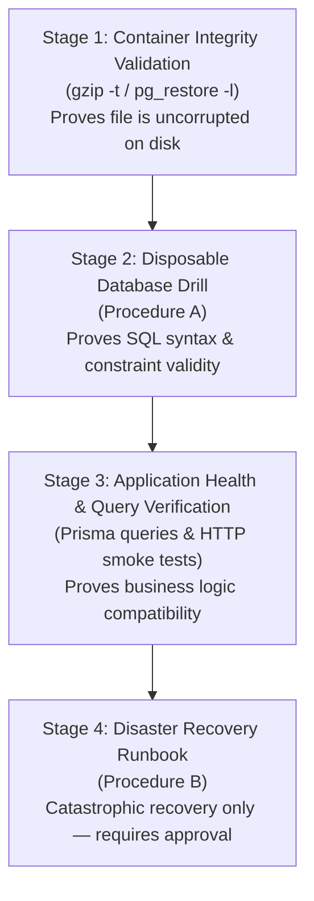

# HARTEK Group CMD Office Command Center — Canonical Deployment & Operations Guide

> **Authoritative Production Operations Guide**  
> *Target System:* Ubuntu Linux 20.04 / 22.04 / 24.04 LTS (Hostinger KVM VPS)  
> *Process Manager:* PM2 (`ecosystem.config.js`)  
> *Reverse Proxy / SSL:* Nginx + Let's Encrypt Certbot  
> *Database:* PostgreSQL 15+ (Prisma ORM)  

---

## 1. System Architecture & Port Allocation

The application runs as two decoupled production services managed by PM2 behind an Nginx reverse proxy:

| Service | Internal Port | Process Manager Name | Artifact Path | Public Path |
| :--- | :--- | :--- | :--- | :--- |
| **Backend API (NestJS 11)** | `4000` | `cmd-backend` | `backend/dist/src/main.js` | `https://<domain>/api/` |
| **Frontend Web (Next.js 16)** | `3000` | `cmd-frontend` | `frontend/.next` | `https://<domain>/` |
| **Database (PostgreSQL)** | `5432` | `postgresql` service | Managed by systemd | Internal only (`127.0.0.1`) |

---

## 2. Server Prerequisites & One-Time VPS Provisioning

For new or replacement VPS instances:

1. **Run Provisioning Script:**
   ```bash
   chmod +x scripts/setup-server.sh
   ./scripts/setup-server.sh
   ```
   *Installs: Node.js v20 LTS, npm, PostgreSQL, PM2, Nginx, Certbot, build-essential, and configures UFW firewall (ports 22, 80, 443).*

2. **Configure Nginx:**
   Copy the bundled Nginx configuration:
   ```bash
   sudo cp nginx/cmd-dashboard.conf /etc/nginx/sites-available/cmd-dashboard.conf
   sudo ln -s /etc/nginx/sites-available/cmd-dashboard.conf /etc/nginx/sites-enabled/
   # Update YOUR_DOMAIN.com in /etc/nginx/sites-available/cmd-dashboard.conf
   sudo nginx -t && sudo systemctl reload nginx
   ```

3. **Install SSL via Certbot:**
   ```bash
   sudo certbot --nginx -d yourdomain.com -d www.yourdomain.com
   ```

---

## 3. Environment Configuration (`.env`)

The application requires environment configuration in the root directory:

```env
# Database Connection (PostgreSQL)
DATABASE_URL="postgresql://<db_user>:<db_password>@127.0.0.1:5432/cmd_office?schema=public"

# Authentication & JWT Secrets
JWT_SECRET="<generate_strong_random_secret_minimum_32_chars>"
JWT_REFRESH_SECRET="<generate_strong_random_secret_minimum_32_chars>"
JWT_ACCESS_EXPIRATION="15m"
JWT_REFRESH_EXPIRATION="7d"
SECURE_COOKIES="true"

# Service Ports & Public URLs
PORT=4000
FRONTEND_URL="https://yourdomain.com"
NEXT_PUBLIC_API_URL="https://yourdomain.com/api"

# Microsoft 365 SMTP Configuration (Optional in .env; manageable via Admin Console)
SMTP_HOST="smtp.office365.com"
SMTP_PORT=587
SMTP_USERNAME="cmd-office@hartek.com"
SMTP_PASSWORD="<app_or_mailbox_password>"
SMTP_SENDER_NAME="HARTEK CMD Office"
SMTP_SENDER_EMAIL="cmd-office@hartek.com"
```

To sync root environment across backend and frontend subprojects:
```bash
node scripts/sync-env.js
```

---

## 4. Canonical Production Release Pipeline

Production releases are managed strictly through version-controlled Git commits on the `main` or `master` branch.

### Standard 3-Step Deployment Procedure:

#### STEP 1: Create Pre-Deployment Backup
Always generate a verified database and application snapshot before deploying code:
```bash
./scripts/backup-production.sh
```
- Performs a full `pg_dump` of PostgreSQL, piping directly through `gzip`.
- Verifies archive integrity with `gzip -t` and checks for the PostgreSQL completion marker (`PostgreSQL database dump complete`).
  > [!NOTE]
  > Database archive verification confirms structural integrity and compression validity. It does not perform a live restore drill against an active database to protect existing production data.
- Creates an application source archive that strictly excludes sensitive files:
  - Excludes `.env*`, `backend/.env*`, `frontend/.env*`
  - Excludes private keys and certificates (`*.key`, `*.pem`, `*.crt`)
  - Excludes `uploads/` and build directories (`node_modules/`, `.next/`, `dist/`)
- **Retention Protection:** Destructive backup pruning is **disabled by default** (`ENABLE_BACKUP_PRUNING=false`) to protect all existing backup archives. Existing backups are never deleted during routine operations.

#### STEP 2: Execute Canonical Deployment
Run the non-interactive automated deployment script inside a persistent terminal session (`tmux` or `screen`):

```bash
# Recommended: Attach to or start a persistent tmux session to protect against network drops
tmux new -s deploy || tmux attach -t deploy

./scripts/deploy-production.sh
```

> [!NOTE]
> **Terminal Session Persistence (`tmux` / `screen`):**
> Running deployments inside a persistent terminal multiplexer (`tmux` or `screen`) ensures that the deployment script survives client-side SSH disconnections, transient network drops, and local terminal window closure. However, terminal multiplexers operate in user space and **cannot** protect processes against non-catchable signals (`SIGKILL`), kernel out-of-memory (OOM) termination, host power loss, or kernel failure. Ensure the server has adequate swap memory configured and always generate a pre-deployment backup.

**Safety Protections Executed Automatically:**
1. **Working Tree Guard:** Rejects deployment if untracked or uncommitted changes exist on the server.
2. **Branch Check:** Verifies server is on `main` or `master` and can be fast-forwarded without merge conflicts.
3. **Non-Blocking Concurrency Lock:** Automatically acquires an exclusive non-blocking lock (`flock` on `.releases/deploy.lock`) to prevent concurrent deployment executions from corrupting Git state, build caches, or active runtime artifacts.
4. **Pre-Build Disk Space Preflight:** Strictly validates that at least 2.0 GB (2,097,152 KB) free disk space is available before compiling candidate builds or snapshotting artifacts (enforcing a 1.5 GB minimum floor if overridden).
5. **Signal & Interruption Hardening:** Catches `SIGHUP` (terminal disconnect), `SIGINT` (Ctrl+C), and `SIGTERM` signals; automatically cleans temporary candidate artifacts and non-destructively reverts Git `HEAD` if interrupted prior to activation.
6. **Migration & Schema Lock:** Scans release diff for migration files (`backend/prisma/migrations/`) or schema changes (`backend/prisma/schema.prisma`). If found, deployment **halts immediately** before touching Git or database state.
7. **Isolated Candidate Worktree Build Architecture:**
   - The candidate commit is prepared inside an isolated Git worktree (`.releases/candidate-worktree`), leaving the active source checkout and branch (`main`) **100% untouched** at `$CURRENT_COMMIT`.
   - Build failures, compilation aborts, or lint errors cannot leave the active checkout detached or modify tracked files.
   - **Dependency Linking & Residual Write-Through Risk:** Candidate worktrees use symlinks to the existing production dependency directories (`backend/node_modules` and `frontend/node_modules`). The Step 3 Dependency Lock checks for dependency-manifest changes (`package.json` and `package-lock.json`), and Step 3 Schema Lock blocks schema changes to avoid `@prisma/client` regeneration. However, standard symlinks do not enforce operating-system-level write protection. Candidate build tools could potentially write through these symlinks, and this residual risk has not been eliminated by the dependency lock.
   - **Candidate Artifact Extraction:** Once NestJS and Next.js builds are verified inside the isolated worktree, compiled artifacts are staged into `backend/dist.candidate` and `frontend/.next.candidate` (both ignored by `.gitignore`), and the temporary worktree is pruned.
8. **Entry Point Verification:** Validates that candidate builds contain required manifests and entry points (`src/main.js`, `src/app.module.js`, `BUILD_ID`, `server`, `static`). If either backend or frontend candidate validation fails, deployment aborts immediately without activating either component.
9. **Interruption-Safe Sequential Directory Activation:**
   - Active release artifacts are snapshotted to `backend/dist.prev` and `frontend/.next.prev`.
   - Directory activation is sequential: backend is swapped first, followed by frontend. Any prior `.old` directory is preserved as `.old.bak` so that no recovery copies are destroyed before verification.
   - **Preservation Guarantee:** Fallback `.old` and `.prev` directories are preserved throughout PM2 reload and health checks. They are only removed after both applications pass health verification.
10. **Process Reload & Sequential Reload Risk:**
    - Reloads PM2 cluster via `pm2 reload ecosystem.config.js`.
    - *Sequential Activation Risk:* PM2 reloads `cmd-backend` and `cmd-frontend` sequentially. During the brief reload window (typically 2-4 seconds), the updated backend may receive requests from the previous frontend, or vice versa. Because database migrations, schema alterations, and dependency updates are blocked in routine deployments, all API changes between adjacent releases must maintain backward compatibility.
11. **Automated Multi-Point Health Probes:**
    - Enforces bounded connection and request timeouts (`--connect-timeout 5 --max-time 10`, 5000ms node fallback).
    - **Backend Response Content Validation:** Probes `/api/settings/public` (port 4000) and strictly verifies that the response returns HTTP 200 OK and valid JSON containing `app_name` or `login_heading`. HTTP 401 Unauthorized, HTTP 403 Forbidden, HTTP 500 Internal Server Error, or HTML error pages are rejected as failures.
    - **Frontend Release Identity Verification:** Probes `http://127.0.0.1:3000/` and validates that the candidate's specific `BUILD_ID` manifest (`/_next/static/${CANDIDATE_BUILD_ID}/_buildManifest.js`) is served, ensuring stale PM2 workers cannot cause false-positive health verification.
    - If health checks fail across 5 attempts (15 seconds), **automatically invokes `scripts/rollback-production.sh`** and preserves all recovery artifacts and metadata.

#### Host Interruption / Uncatchable Signal Recovery (SIGKILL / OOM):
If the deployment process is terminated by an uncatchable signal (`SIGKILL`, host kernel OOM killer, or host power interruption) where exit traps cannot run:
1. The active repository checkout remains cleanly attached to `main` at `$CURRENT_COMMIT`.
2. Temporary worktrees in `.releases/candidate-worktree` are ignored by `.gitignore` and do not dirty `git status`.
3. If `.releases/deploy.lock` is left held by a terminated PID, the next deployment run atomically detects the stale lock and reclaims it safely.
4. If a stale worktree is left behind, the next deployment automatically detects and removes it via `git worktree remove --force .releases/candidate-worktree && git worktree prune`.
5. Manual cleanup command (if desired):
   ```bash
   git worktree remove --force .releases/candidate-worktree 2>/dev/null || rm -rf .releases/candidate-worktree
   git worktree prune
   git status  # Verified clean working tree on main
   ```

---

## 5. Emergency Rollback Procedures

### Automated Rollback (Self-Healing)
If `deploy-production.sh` detects that application endpoints fail to pass verification after deployment, it immediately disarms failure traps, preserves recovery snapshots, and executes `scripts/rollback-production.sh`.

### Manual Emergency Rollback
If an issue is detected after deployment approval, execute:
```bash
./scripts/rollback-production.sh
```
**What the Rollback Script Does:**
1. **Safety Preflight:** Checks working tree cleanliness, permitting only legitimate `.prev` snapshots and release metadata.
2. **Artifact Verification:** Verifies the presence and structural integrity of `backend/dist.prev` and `frontend/.next.prev` (`src/main.js`, `BUILD_ID`).
3. **Metadata Validation:** Reads the previous release commit from `.prev-deployed-commit` or `.releases/previous-release.json` and verifies that it is a valid Git commit. If metadata is missing or corrupted, rollback fails closed to prevent guessing commits.
4. **Non-Destructive Sequential Restoration:**
   - Active production directories are preserved to `.old.bak`.
   - Preserved `.prev` artifacts are copied (not moved) into active paths, ensuring repeated rollback attempts can be executed idempotently without destroying recovery files.
   - **Git Checkout Safety:** PM2 executes strictly from compiled directories (`backend/dist` and `frontend/.next`). Rollback restores the compiled application runtime **without altering the active Git checkout or detaching HEAD**. The server remains cleanly on `main` so that subsequent automated deployments succeed without manual Git intervention.
5. **Process Reload:** Reloads PM2 processes (`pm2 reload ecosystem.config.js || pm2 restart all`).
6. **Health Verification:** Verifies backend settings JSON payload and frontend responsiveness with bounded timeouts.
7. **Recovery Preservation:** If rollback verification succeeds, `.current-deployed-commit` is updated, `.old` and `.old.bak` are cleaned up, and `.prev` artifacts are safely maintained. If rollback verification fails, all recovery files (`.prev`, `.old`, `.prev-deployed-commit`) are preserved for operator inspection.

---

## 6. Database Restoration, Disaster Recovery & Off-Site Strategy

> [!CRITICAL]
> **Data Preservation Hazard & Non-Merge Semantics:**
> Neither plain SQL dumps (`.sql.gz`) nor PostgreSQL custom archives (`.dump`) represent differential patches or data merges.
> A database backup **must never** be restored or piped into an existing, populated production database (`cmd_office`) as a routine deployment action.
> Restoring a dump into an active database will cause immediate primary key collisions (`duplicate key value violates unique constraint`), foreign key violations, and partial state corruption.
> Always execute restoration tests inside an isolated disposable database or dedicated staging environment following the procedures below.

---

### 6.1 Backup Format Specification & Container Integrity Verification

The HARTEK CMD system supports two distinct PostgreSQL archive formats. Each format requires a specific integrity check and restoration utility:

| Format Attribute | Gzip Plain-Text SQL (`.sql.gz`) | PostgreSQL Custom Archive (`.dump` / `.fc`) |
| :--- | :--- | :--- |
| **Origin in Pipeline** | Produced by `scripts/backup-production.sh` (`pg_dump "$URL" \| gzip > db-backup-$TIMESTAMP.sql.gz`) | Historical production baseline dumps produced via `pg_dump -Fc` |
| **File Structure** | Gzip-compressed plain-text SQL statements | Binary archive containing internal Table of Contents (TOC) and compressed data blocks |
| **Integrity Check** | `gzip -t "$ARCHIVE"` + completion marker check | `pg_restore -l "$ARCHIVE" > /dev/null` (verifies readable TOC) |
| **Restore Utility** | `gzip -dc "$ARCHIVE" \| psql -U postgres -d "$TARGET_DB" -v ON_ERROR_STOP=1` | `pg_restore -U postgres -d "$TARGET_DB" --no-owner --no-privileges --exit-on-error "$ARCHIVE"` |
| **Piped `psql` Safe?** | **YES** (Standard SQL stream) | **NO** (Fails with `ERROR: syntax error at or near "PGDMP"`) |
| **Selective Restore Support** | No (requires manual text stream manipulation) | Yes (supports `-t`, `-L`, `--schema`, and parallel worker `-j` flags) |

> [!NOTE]
> **Why `--clean` Is Not Required During Target Initialization:**
> In Procedures A, B, and C, an empty target database is created fresh (`createdb`) before restoration.
> Because an empty database contains no pre-existing tables, indexes, or sequences, the `--clean` (`DROP` objects before recreating) and `--if-exists` flags are completely redundant.
> Restoring into a fresh database without `--clean` avoids noisy `DROP ... does not exist` notices, while `--no-owner` and `--no-privileges` allow objects to restore cleanly into local environments regardless of remote role naming.

#### Format Detection Logic
When operating on an arbitrary backup archive, detect the file format using container magic bytes rather than file extensions:

```bash
# Read initial 5 bytes of archive header
MAGIC_HEADER=$(head -c 5 "$BACKUP_ARCHIVE" 2>/dev/null || echo "")

if [[ "$MAGIC_HEADER" == "PGDMP"* ]]; then
    ARCHIVE_FORMAT="PG_CUSTOM_DUMP"
elif gzip -t "$BACKUP_ARCHIVE" 2>/dev/null; then
    if gzip -dc "$BACKUP_ARCHIVE" | head -n 30 | grep -qE "(PostgreSQL database dump|SET |CREATE )"; then
        ARCHIVE_FORMAT="GZIP_SQL"
    else
        ARCHIVE_FORMAT="UNKNOWN"
    fi
else
    ARCHIVE_FORMAT="UNKNOWN"
fi
```

---

### 6.2 Multi-Stage Verification Boundary: From Container to Production Recovery

Operational safety requires maintaining a strict distinction between the four progressive levels of backup verification:



> [!WARNING]
> **Container Integrity vs. Database Restoration Proof:**
> A successful archive container check (`gzip -t` or `pg_restore -l`) proves **ONLY** that:
> 1. The container file is physically uncorrupted on disk.
> 2. The compressed blocks and internal Table of Contents are readable without I/O or CRC errors.
>
> A successful container check **DOES NOT** establish:
> - That the SQL statements or custom archive objects are syntactically valid for the target PostgreSQL server version.
> - That tables, columns, constraints, and sequences match active application Prisma schema migrations.
> - That transactional data, foreign keys, or unique indexes will restore without constraint violations.
> - That application services (NestJS API / Next.js UI) can successfully authenticate, query, or mutate data in the restored state.
>
> True restoration validity can **only** be established by completing a full restoration into an isolated database, executing post-restore data assertions, and performing application health probes.

1. **Stage 1: Physical Archive Integrity Validation:**
   - Tests container structure, CRC checksums, and Table of Contents (`gzip -t` or `pg_restore -l`).
   - Confirms the archive is not truncated or corrupted on disk.
   - **Boundary Notice:** Proves *only* container readability; does *not* prove that data can be restored or queried.
2. **Stage 2: Isolated Scratch Database Restoration Drill (Procedure A):**
   - Restores the archive into a temporary, uniquely named disposable database.
   - Proves that SQL DDL/DML, custom TOC items, indexes, and foreign keys load cleanly without constraint errors.
   - Confirms basic row existence in core tables (`User`, `Role`, `_prisma_migrations`).
3. **Stage 3: Application-Level Verification & Integration Testing:**
   - Boots backend and frontend test runners against the restored dataset (after applying staging sanitization).
   - Proves that password hashes, JWT verification, multi-table relations, and business logic operate correctly.
   - **Boundary Notice:** Row count checks alone do not establish application correctness.
4. **Stage 4: Controlled Production Disaster Recovery (Procedure B):**
   - Documented operational protocol reserved strictly for complete data destruction scenarios.
   - Alters production database state. Must never be executed as part of routine deployment.

---

### Procedure A: Isolated Verification & Disposable Scratch Database Restoration Drill (Default)

Use this non-destructive procedure to verify backup data completeness, test new schema migrations, or conduct operator disaster-recovery drills without touching production or staging databases.

> [!NOTE]
> **Operational Note:** This procedure is a documented operational protocol. No live database restoration drill has been executed during this pre-deployment review.

#### Step 1: Locate and Validate Backup Archive Integrity
```bash
set -euo pipefail

BACKUP_DIR="${BACKUP_DIR:-/var/backups/cmd-dashboard}"

# Explicit archive selection:
# When verifying a specific backup—especially the known historical production baseline:
#   /var/backups/cmd-dashboard/cmd_office_predeploy_20261030_110915.dump
# always supply the exact file path as an argument ($1).
BACKUP_ARCHIVE="${1:-${BACKUP_ARCHIVE:-}}"

if [ -z "$BACKUP_ARCHIVE" ]; then
    echo "  [DISCOVERY] No explicit archive path passed. Attempting automated baseline discovery..."
    # 1. Check for specific known production baseline archive
    if [ -f "$BACKUP_DIR/cmd_office_predeploy_20261030_110915.dump" ]; then
        BACKUP_ARCHIVE="$BACKUP_DIR/cmd_office_predeploy_20261030_110915.dump"
        echo "  [DISCOVERY] Located known historical baseline: $BACKUP_ARCHIVE"
    else
        # 2. Check for latest automated deployment backup subdirectory
        LATEST_DIR=$(ls -td "$BACKUP_DIR"/backup-* 2>/dev/null | head -n 1)
        if [ -n "$LATEST_DIR" ]; then
            if [ -f "$LATEST_DIR/$(basename "$LATEST_DIR" | sed 's/backup-/db-backup-/').sql.gz" ]; then
                BACKUP_ARCHIVE="$LATEST_DIR/$(basename "$LATEST_DIR" | sed 's/backup-/db-backup-/').sql.gz"
            elif [ -f "$LATEST_DIR/$(basename "$LATEST_DIR" | sed 's/backup-/db-backup-/').dump" ]; then
                BACKUP_ARCHIVE="$LATEST_DIR/$(basename "$LATEST_DIR" | sed 's/backup-/db-backup-/').dump"
            fi
        fi
    fi
fi

if [ -z "$BACKUP_ARCHIVE" ]; then
    echo "[CRITICAL ERROR] No backup archive located automatically under '$BACKUP_DIR'!" >&2
    echo "Archive discovery is ambiguous. An explicit path must be provided:" >&2
    echo "  Usage: ./restore-drill.sh /var/backups/cmd-dashboard/cmd_office_predeploy_20261030_110915.dump" >&2
    exit 1
fi

if [ ! -f "$BACKUP_ARCHIVE" ] || [ ! -s "$BACKUP_ARCHIVE" ]; then
    echo "[CRITICAL ERROR] Target backup file '$BACKUP_ARCHIVE' is missing or 0 bytes!" >&2
    exit 1
fi

echo "Evaluating candidate archive: $BACKUP_ARCHIVE"

# Format detection and format-specific container validation
MAGIC_HEADER=$(head -c 5 "$BACKUP_ARCHIVE" 2>/dev/null || echo "")

if [[ "$MAGIC_HEADER" == "PGDMP"* ]]; then
    ARCHIVE_FORMAT="PG_CUSTOM_DUMP"
    echo "  Detected Format: PostgreSQL Custom Archive (.dump)"
    if ! pg_restore -l "$BACKUP_ARCHIVE" > /dev/null 2>&1; then
        echo "[CRITICAL ERROR] Archive container check failed: Invalid or corrupted custom dump TOC!" >&2
        exit 1
    fi
    echo "  [OK] Custom dump Table of Contents verified readable."

elif gzip -t "$BACKUP_ARCHIVE" 2>/dev/null; then
    ARCHIVE_FORMAT="GZIP_SQL"
    echo "  Detected Format: Gzip Plain-Text SQL (.sql.gz)"
    if ! gzip -dc "$BACKUP_ARCHIVE" | tail -n 25 | grep -q "PostgreSQL database dump complete"; then
        echo "[CRITICAL ERROR] Archive verification failed: Truncated dump (missing PostgreSQL completion marker)!" >&2
        exit 1
    fi
    echo "  [OK] Gzip CRC integrity and PostgreSQL completion marker present."

else
    echo "[CRITICAL ERROR] Unrecognized or corrupted backup file format in '$BACKUP_ARCHIVE'!" >&2
    exit 1
fi
```

#### Step 2: Create Explicit Disposable Scratch Database with Fail-Closed Guards
```bash
# Generate collision-resistant disposable scratch database name using timestamp and entropy
VERIFY_DB="cmd_restore_verification_$(date +%Y%m%d_%H%M%S)_$RANDOM"

# Positive safety assertion: database name must match collision-resistant scratch pattern
if [[ ! "$VERIFY_DB" =~ ^cmd_restore_verification_[0-9]{8}_[0-9]{6}_[0-9]+$ ]]; then
    echo "[CRITICAL ERROR] Generated database name '$VERIFY_DB' does not match safe verification pattern! Aborting." >&2
    exit 1
fi

# Negative fail-closed guard: explicitly block production or staging targets
if [ "$VERIFY_DB" = "cmd_office" ] || [ "$VERIFY_DB" = "cmd_office_staging" ]; then
    echo "[CRITICAL ERROR] Refusing to create or target protected database '$VERIFY_DB'!" >&2
    exit 1
fi

createdb -U postgres "$VERIFY_DB"
echo "Created isolated verification database: $VERIFY_DB"
```

#### Step 3: Execute Restoration into Disposable Scratch Database
```bash
set -o pipefail
RESTORE_STATUS=0

if [ "$ARCHIVE_FORMAT" = "GZIP_SQL" ]; then
    echo "Restoring plain-text SQL archive into $VERIFY_DB via psql..."
    set +e
    gzip -dc "$BACKUP_ARCHIVE" | psql -U postgres -d "$VERIFY_DB" -v ON_ERROR_STOP=1
    RESTORE_STATUS=$?
    set -e

elif [ "$ARCHIVE_FORMAT" = "PG_CUSTOM_DUMP" ]; then
    echo "Restoring custom-format archive into $VERIFY_DB via pg_restore..."
    set +e
    pg_restore -U postgres \
        --dbname="$VERIFY_DB" \
        --no-owner \
        --no-privileges \
        --exit-on-error \
        "$BACKUP_ARCHIVE"
    RESTORE_STATUS=$?
    set -e
fi

if [ "$RESTORE_STATUS" -ne 0 ]; then
    echo "[CRITICAL ERROR] Restoration pipeline failed with exit code: $RESTORE_STATUS!" >&2
    echo "Preserving disposable database '$VERIFY_DB' for forensic error inspection." >&2
    exit "$RESTORE_STATUS"
fi

echo "[SUCCESS] Archive restored cleanly into verification database: $VERIFY_DB"
```

#### Step 4: Verify Schema, Object Counts & Relational Integrity
```bash
# 1. Inspect table counts across essential models
psql -U postgres -d "$VERIFY_DB" -v ON_ERROR_STOP=1 -c "
SELECT 'User' AS model, COUNT(*) AS count FROM \"User\"
UNION ALL
SELECT 'Role' AS model, COUNT(*) AS count FROM \"Role\"
UNION ALL
SELECT 'Task' AS model, COUNT(*) AS count FROM \"Task\"
UNION ALL
SELECT 'Department' AS model, COUNT(*) AS count FROM \"Department\"
UNION ALL
SELECT '_prisma_migrations' AS model, COUNT(*) AS count FROM \"_prisma_migrations\";
"

# 2. Inspect latest Prisma migration records
psql -U postgres -d "$VERIFY_DB" -v ON_ERROR_STOP=1 -c "
SELECT id, migration_name, finished_at, rolled_back_at
FROM \"_prisma_migrations\"
ORDER BY finished_at DESC LIMIT 5;
"

# 3. Automated assertions: fail closed if essential tables are empty
RECORD_COUNT_USER=$(psql -U postgres -d "$VERIFY_DB" -t -A -c "SELECT COUNT(*) FROM \"User\";")
RECORD_COUNT_ROLE=$(psql -U postgres -d "$VERIFY_DB" -t -A -c "SELECT COUNT(*) FROM \"Role\";")
RECORD_COUNT_MIGRATIONS=$(psql -U postgres -d "$VERIFY_DB" -t -A -c "SELECT COUNT(*) FROM \"_prisma_migrations\";")

if [ "$RECORD_COUNT_USER" -eq 0 ] || [ "$RECORD_COUNT_ROLE" -eq 0 ] || [ "$RECORD_COUNT_MIGRATIONS" -eq 0 ]; then
    echo "[CRITICAL ERROR] Automated data verification failed: Essential tables are empty!" >&2
    echo "User count: $RECORD_COUNT_USER, Role count: $RECORD_COUNT_ROLE, Migrations count: $RECORD_COUNT_MIGRATIONS" >&2
    exit 1
fi
echo "[SUCCESS] Automated data assertions passed: Essential tables and migration records verified."
```

> [!NOTE]
> **Data Assertion Scope & Limitations:**
> Non-zero record counts in `User`, `Role`, and `_prisma_migrations` verify that schema creation and data loading completed.
> However, row counts alone **do not prove full application correctness**.
> They do not verify password hash validity, foreign key relationship integrity under complex application queries, JWT decryption against current environment secrets, or business transaction execution. Full application validation occurs in Stage 3.

#### Step 5: Clean Up Disposable Scratch Database
```bash
# Strict fail-closed deletion guard: target must strictly match scratch prefix
if [[ -n "${VERIFY_DB:-}" && "$VERIFY_DB" =~ ^cmd_restore_verification_[0-9]{8}_[0-9]{6}_[0-9]+$ ]]; then
    dropdb -U postgres "$VERIFY_DB"
    echo "Safely removed verification scratch database: $VERIFY_DB"
else
    echo "[CRITICAL ERROR] Target database '$VERIFY_DB' does not match safe verification prefix! Aborting drop to protect databases." >&2
    exit 1
fi
```

> [!IMPORTANT]
> **Failure Behavior & Scratch Database Retention:**
> If restoration (Step 3) or data verification (Step 4) encounters an error, the script exits immediately with a non-zero exit code **without reaching Step 5**.
> The scratch database (`cmd_restore_verification_*`) is intentionally **preserved** in its failed state to enable forensic investigation of PostgreSQL error logs, table contents, and constraint violations.
> Once troubleshooting is complete, operators can manually remove the failed scratch database after verifying its name:
> ```bash
> # Verify exact scratch name before dropping
> if [[ "$FAILED_DB" =~ ^cmd_restore_verification_[0-9]{8}_[0-9]{6}_[0-9]+$ ]]; then
>     dropdb -U postgres "$FAILED_DB"
> fi
> ```

---

### Procedure B: Controlled Production Disaster Recovery (Catastrophic Loss Only)

> [!CRITICAL]
> **DISASTER RECOVERY ONLY — NEVER EXECUTE DURING ROUTINE DEPLOYMENT:**
> This procedure is reserved strictly for complete data loss recovery scenarios (e.g. storage volume reconstruction, unrecoverable disk failure, corrupted database cluster rebuild).
> It permanently modifies production state, halts application ingress, severs database connections, and renames the active database.
> **Destructive Commands Warning:** Commands such as `pm2 stop`, `ALTER DATABASE cmd_office RENAME`, `createdb cmd_office`, and `pg_restore ... cmd_office` must **NEVER** be executed during a routine patch or zero-downtime deployment.
> Routine deployments use strictly `scripts/deploy-production.sh` with `pm2 reload`.
>
> **Prerequisites for Disaster Recovery Execution:**
> 1. An explicitly authorized human operator and approved emergency maintenance window.
> 2. An explicitly specified, non-empty backup archive whose container integrity has been fully verified *prior* to taking any disruptive action.
> 3. An independent operational decision confirming that current production data cannot be recovered without a full restore.
> 4. Full application downtime.
> 5. Operational Note: This procedure is a documented operational protocol and has **not** been executed against live production.

1. **Locate & Pre-Validate Candidate Archive BEFORE Service Interruption (Preflight Gate):**
   *Never halt application services or touch the database before confirming that the target archive is fully readable and structurally intact.*
   ```bash
   set -euo pipefail

   # Mandatory explicit archive selection: do not rely on implicit or ambiguous defaults
   BACKUP_ARCHIVE="${1:-${BACKUP_ARCHIVE:-}}"
   if [ -z "$BACKUP_ARCHIVE" ]; then
       echo "[CRITICAL ERROR] Disaster recovery requires an explicit backup archive path!" >&2
       echo "  Usage: ./restore-disaster-recovery.sh /path/to/archive.dump (or .sql.gz)" >&2
       echo "  Example baseline: /var/backups/cmd-dashboard/cmd_office_predeploy_20261030_110915.dump" >&2
       exit 1
   fi

   if [ ! -f "$BACKUP_ARCHIVE" ] || [ ! -s "$BACKUP_ARCHIVE" ]; then
       echo "[CRITICAL ERROR] Disaster recovery candidate '$BACKUP_ARCHIVE' is missing or 0 bytes!" >&2
       exit 1
   fi

   echo "==> Pre-Flight: Validating Archive Container Integrity Prior to Outage..."
   MAGIC_HEADER=$(head -c 5 "$BACKUP_ARCHIVE" 2>/dev/null || echo "")

   if [[ "$MAGIC_HEADER" == "PGDMP"* ]]; then
       ARCHIVE_FORMAT="PG_CUSTOM_DUMP"
       echo "  [FORMAT] Detected PostgreSQL Custom Format Archive (.dump)."
       if ! pg_restore -l "$BACKUP_ARCHIVE" > /dev/null 2>&1; then
           echo "[CRITICAL ERROR] Pre-flight failed: Invalid or corrupted Table of Contents in '$BACKUP_ARCHIVE'!" >&2
           echo "Refusing to disrupt production services for a corrupt archive." >&2
           exit 1
       fi
       echo "  [OK] Custom dump Table of Contents verified readable."

   elif gzip -t "$BACKUP_ARCHIVE" 2>/dev/null; then
       ARCHIVE_FORMAT="GZIP_SQL"
       echo "  [FORMAT] Detected Gzip Plain-Text SQL Archive (.sql.gz)."
       if ! gzip -dc "$BACKUP_ARCHIVE" | tail -n 25 | grep -q "PostgreSQL database dump complete"; then
           echo "[CRITICAL ERROR] Pre-flight failed: Missing PostgreSQL completion marker in '$BACKUP_ARCHIVE'!" >&2
           echo "Refusing to disrupt production services for a truncated archive." >&2
           exit 1
       fi
       echo "  [OK] Gzip CRC integrity and PostgreSQL completion marker verified."

   else
       echo "[CRITICAL ERROR] Unrecognized or unsupported archive format in '$BACKUP_ARCHIVE'!" >&2
       echo "Refusing to disrupt production services for an unknown archive." >&2
       exit 1
   fi
   echo "  [SUCCESS] Pre-flight validation passed. Candidate archive is intact."
   ```

2. **Halt Application Ingress (Disaster Recovery Only):**
   ```bash
   cd /var/www/cmd-dashboard
   pm2 stop ecosystem.config.js
   ```

3. **Capture Emergency Safety Snapshot of Current Database State:**
   Even if the database is in an inconsistent state, always take an emergency pre-recovery snapshot before proceeding:
   ```bash
   pg_dump -U postgres cmd_office | gzip > "/var/backups/cmd-dashboard/emergency-pre-restore-$(date +%Y%m%d-%H%M%S).sql.gz" || true
   ```

4. **Terminate Active Database Connections (Disaster Recovery Only):**
   ```bash
   psql -U postgres -c "
   SELECT pg_terminate_backend(pid)
   FROM pg_stat_activity
   WHERE datname = 'cmd_office' AND pid <> pg_backend_pid();
   "
   ```

5. **Isolate Compromised Database & Initialize Clean Target (Disaster Recovery Only):**
   ```bash
   # Rename existing database rather than dropping to preserve forensic copy
   psql -U postgres -c "ALTER DATABASE cmd_office RENAME TO cmd_office_corrupted_$(date +%Y%m%d_%H%M%S);"

   # Create fresh, clean production database
   createdb -U postgres -O postgres cmd_office
   ```

6. **Execute Restoration with Format-Appropriate Tooling (Disaster Recovery Only):**
   ```bash
   set -euo pipefail

   if [ "$ARCHIVE_FORMAT" = "PG_CUSTOM_DUMP" ]; then
       echo "Restoring PostgreSQL custom format archive (.dump) via pg_restore..."
       pg_restore -U postgres \
           --dbname=cmd_office \
           --no-owner \
           --no-privileges \
           --exit-on-error \
           "$BACKUP_ARCHIVE"
   elif [ "$ARCHIVE_FORMAT" = "GZIP_SQL" ]; then
       echo "Restoring plain-text SQL archive (.sql.gz) via psql..."
       set -o pipefail
       gzip -dc "$BACKUP_ARCHIVE" | psql -U postgres -d cmd_office -v ON_ERROR_STOP=1
   fi
   echo "[SUCCESS] Archive data restored into fresh cmd_office database."
   ```

7. **Re-Apply Database Role Ownership & Schema Grants (Disaster Recovery Only):**
   Because `psql` and `pg_restore` restore tables under the executing superuser (`postgres`), ensure the application runtime user (e.g. `cmd_user` configured in `DATABASE_URL`) has requisite privileges:
   ```bash
   APP_DB_USER="cmd_user" # Verify from backend/.env DATABASE_URL
   psql -U postgres -d cmd_office -c "
   GRANT ALL ON SCHEMA public TO ${APP_DB_USER};
   GRANT ALL PRIVILEGES ON ALL TABLES IN SCHEMA public TO ${APP_DB_USER};
   GRANT ALL PRIVILEGES ON ALL SEQUENCES IN SCHEMA public TO ${APP_DB_USER};
   ALTER DEFAULT PRIVILEGES IN SCHEMA public GRANT ALL ON TABLES TO ${APP_DB_USER};
   ALTER DEFAULT PRIVILEGES IN SCHEMA public GRANT ALL ON SEQUENCES TO ${APP_DB_USER};
   "
   ```

8. **Verify Application Health & Restart Services (Disaster Recovery Only):**
   ```bash
   pm2 start ecosystem.config.js
   pm2 status
   curl -f http://127.0.0.1:4000/api/settings/public
   curl -f http://127.0.0.1:3000/
   ```

---

### Procedure C: Approved Staging Database Restoration & Verification Runbook

> [!CRITICAL]
> **Production Protection & Strict Target Isolation:**
> Database restoration must **NEVER** be targeted at the production database (`cmd_office`).
> This procedure is reserved strictly for restoring a baseline dump into the **approved staging database** (`cmd_office_staging`).
> The destination database identity must be positively asserted prior to executing any destructive command (`DROP DATABASE`, `CREATE DATABASE`, or SQL restore stream).

#### Staging Database Restoration Pipeline:
The following automated restoration runbook enforces POSIX pipeline failure handling, physical archive verification, strict target assertion, operator confirmation, and comprehensive schema verification.

> [!NOTE]
> **Operational Directive:** This documentation provides the canonical runbook. **Do not execute any restore command** without explicit operational authorization and maintenance scheduling.

```bash
#!/usr/bin/env bash
# ------------------------------------------------------------------------------
# Canonical Staging Database Restoration Script
# Target: Approved Staging Database ONLY (cmd_office_staging)
# Supports: .sql.gz (Plain SQL Gzip) and .dump (PostgreSQL Custom Format)
# ------------------------------------------------------------------------------
set -euo pipefail

# 1. Define and verify destination staging database target
STAGING_DB_TARGET="${STAGING_DB_NAME:-cmd_office_staging}"
PROD_DB_NAME="cmd_office"

echo "==> Step 1: Validating Destination Target Safety..."
# Strict fail-closed guard: ensure destination is NOT production
if [ "$STAGING_DB_TARGET" = "$PROD_DB_NAME" ]; then
    echo "[CRITICAL ERROR] Target database cannot be production database ('$PROD_DB_NAME')!" >&2
    echo "Restoration aborted immediately to protect production data." >&2
    exit 1
fi

# Positive assertion: destination database name must include staging qualifier
if [[ ! "$STAGING_DB_TARGET" =~ (staging|stage|test) ]]; then
    echo "[CRITICAL ERROR] Destination database '$STAGING_DB_TARGET' does not match approved staging naming pattern!" >&2
    echo "Staging database must explicitly contain 'staging', 'stage', or 'test'." >&2
    exit 1
fi

echo "  [VERIFIED] Approved staging destination target: $STAGING_DB_TARGET"

# Operator confirmation gate: require explicit confirmation before dropping existing staging data
if [ "${CONFIRM_DISCARD_STAGING_DATA:-false}" != "true" ]; then
    echo "------------------------------------------------------------------------"
    echo "  [STAGING DESTRUCTION WARNING] Existing staging database will be dropped."
    echo "  Target: '$STAGING_DB_TARGET'"
    echo "  All active connections will be severed and all existing staging tables"
    echo "  and data will be permanently destroyed."
    echo "------------------------------------------------------------------------"
    read -r -p "Type '$STAGING_DB_TARGET' to confirm destruction and continue: " CONFIRM_NAME
    if [ "$CONFIRM_NAME" != "$STAGING_DB_TARGET" ]; then
        echo "[CRITICAL ERROR] Operator confirmation mismatch ('$CONFIRM_NAME' != '$STAGING_DB_TARGET'). Aborting!" >&2
        exit 1
    fi
fi

# 2. Locate backup archive and verify existence and non-empty status
# Explicit archive selection: when restoring a specific baseline—such as:
#   /var/backups/cmd-dashboard/cmd_office_predeploy_20261030_110915.dump
# always supply the exact file path as argument ($1).
BACKUP_ARCHIVE="${1:-${BACKUP_ARCHIVE:-}}"

if [ -z "$BACKUP_ARCHIVE" ]; then
    BACKUP_DIR="${BACKUP_DIR:-/var/backups/cmd-dashboard}"
    # Check for known historical baseline archive first
    if [ -f "$BACKUP_DIR/cmd_office_predeploy_20261030_110915.dump" ]; then
        BACKUP_ARCHIVE="$BACKUP_DIR/cmd_office_predeploy_20261030_110915.dump"
        echo "  [DISCOVERY] Selected known baseline archive: $BACKUP_ARCHIVE"
    else
        LATEST_DIR=$(ls -td "$BACKUP_DIR"/backup-* 2>/dev/null | head -n 1)
        if [ -n "$LATEST_DIR" ]; then
            if [ -f "$LATEST_DIR/$(basename "$LATEST_DIR" | sed 's/backup-/db-backup-/').sql.gz" ]; then
                BACKUP_ARCHIVE="$LATEST_DIR/$(basename "$LATEST_DIR" | sed 's/backup-/db-backup-/').sql.gz"
            elif [ -f "$LATEST_DIR/$(basename "$LATEST_DIR" | sed 's/backup-/db-backup-/').dump" ]; then
                BACKUP_ARCHIVE="$LATEST_DIR/$(basename "$LATEST_DIR" | sed 's/backup-/db-backup-/').dump"
            fi
        fi
    fi
fi

if [ -z "$BACKUP_ARCHIVE" ]; then
    echo "[CRITICAL ERROR] No backup archive located under '$BACKUP_DIR'!" >&2
    echo "Archive discovery is ambiguous. An explicit path must be provided:" >&2
    echo "  Usage: ./restore-staging.sh /var/backups/cmd-dashboard/cmd_office_predeploy_20261030_110915.dump" >&2
    exit 1
fi

echo "==> Step 2: Verifying Backup File Existence & Non-Empty Check..."
if [ ! -f "$BACKUP_ARCHIVE" ]; then
    echo "[CRITICAL ERROR] Backup file '$BACKUP_ARCHIVE' does not exist!" >&2
    exit 1
fi

if [ ! -s "$BACKUP_ARCHIVE" ]; then
    echo "[CRITICAL ERROR] Backup file '$BACKUP_ARCHIVE' is empty (0 bytes)!" >&2
    exit 1
fi

FILE_SIZE_BYTES=$(wc -c < "$BACKUP_ARCHIVE" | tr -d ' ')
echo "  [VERIFIED] Backup file exists: $BACKUP_ARCHIVE ($FILE_SIZE_BYTES bytes)"

# 3. Detect Format and Verify Container Integrity
echo "==> Step 3: Detecting Archive Format & Verifying Container Integrity..."
MAGIC_HEADER=$(head -c 5 "$BACKUP_ARCHIVE" 2>/dev/null || echo "")

if [[ "$MAGIC_HEADER" == "PGDMP"* ]]; then
    ARCHIVE_FORMAT="PG_CUSTOM_DUMP"
    echo "  [FORMAT] Detected PostgreSQL Custom Format Archive (.dump)."
    if ! pg_restore -l "$BACKUP_ARCHIVE" > /dev/null 2>&1; then
        echo "[CRITICAL ERROR] Archive Table of Contents validation failed for '$BACKUP_ARCHIVE'!" >&2
        exit 1
    fi
    echo "  [VERIFIED] Custom archive Table of Contents is structurally intact."

elif gzip -t "$BACKUP_ARCHIVE" 2>/dev/null; then
    ARCHIVE_FORMAT="GZIP_SQL"
    echo "  [FORMAT] Detected Gzip Plain-Text SQL Archive (.sql.gz)."
    echo "  [VERIFIED] Archive gzip decompression integrity valid."

    echo "==> Step 4: Inspecting PostgreSQL Dump Completion Marker..."
    if ! gzip -dc "$BACKUP_ARCHIVE" | tail -n 25 | grep -q "PostgreSQL database dump complete"; then
        echo "[CRITICAL ERROR] Archive is missing PostgreSQL dump completion marker!" >&2
        echo "The backup file may have been terminated prematurely during pg_dump." >&2
        exit 1
    fi
    echo "  [VERIFIED] PostgreSQL dump completion marker present."

else
    echo "[CRITICAL ERROR] Unrecognized or corrupt archive format for '$BACKUP_ARCHIVE'!" >&2
    exit 1
fi

# ------------------------------------------------------------------------------
# ARCHIVE VERIFICATION BOUNDARY NOTICE:
# A successful container check verifies ONLY physical integrity and TOC readability.
# It does NOT prove SQL syntax validity against the running server, schema compatibility,
# foreign key consistency, or successful application startup.
# ------------------------------------------------------------------------------

# 5. Initialize clean staging destination database
echo "==> Step 5: Initializing Clean Staging Database: $STAGING_DB_TARGET..."
# Terminate existing connections to staging database
psql -U postgres -v ON_ERROR_STOP=1 -c "
SELECT pg_terminate_backend(pid)
FROM pg_stat_activity
WHERE datname = '$STAGING_DB_TARGET' AND pid <> pg_backend_pid();
" || true

# Drop existing staging database if present
psql -U postgres -v ON_ERROR_STOP=1 -c "DROP DATABASE IF EXISTS \"$STAGING_DB_TARGET\";"
# Create clean staging database
psql -U postgres -v ON_ERROR_STOP=1 -c "CREATE DATABASE \"$STAGING_DB_TARGET\" WITH OWNER postgres ENCODING 'UTF8';"

# 6. Execute format-appropriate restoration pipeline
echo "==> Step 6: Executing Restoration Pipeline..."
RESTORE_STATUS=0
set +e

if [ "$ARCHIVE_FORMAT" = "GZIP_SQL" ]; then
    gzip -dc "$BACKUP_ARCHIVE" | psql -U postgres -d "$STAGING_DB_TARGET" -v ON_ERROR_STOP=1
    RESTORE_STATUS=$?
elif [ "$ARCHIVE_FORMAT" = "PG_CUSTOM_DUMP" ]; then
    pg_restore -U postgres \
        --dbname="$STAGING_DB_TARGET" \
        --no-owner \
        --no-privileges \
        --exit-on-error \
        "$BACKUP_ARCHIVE"
    RESTORE_STATUS=$?
fi
set -e

if [ "$RESTORE_STATUS" -ne 0 ]; then
    echo "[CRITICAL ERROR] Database restoration pipeline failed with exit code: $RESTORE_STATUS!" >&2
    echo "Destructive changes or partial restoration state detected. Do not proceed with deployment." >&2
    exit "$RESTORE_STATUS"
fi
echo "  [SUCCESS] Database restoration completed with exit status: 0."

# 7. Grant staging application database user permissions
echo "==> Step 7: Configuring Staging Database Privileges..."
STAGING_DB_USER="${STAGING_DB_USER:-cmd_staging_user}"
psql -U postgres -d "$STAGING_DB_TARGET" -v ON_ERROR_STOP=1 -c "
GRANT ALL ON SCHEMA public TO \"${STAGING_DB_USER}\";
GRANT ALL PRIVILEGES ON ALL TABLES IN SCHEMA public TO \"${STAGING_DB_USER}\";
GRANT ALL PRIVILEGES ON ALL SEQUENCES IN SCHEMA public TO \"${STAGING_DB_USER}\";
ALTER DEFAULT PRIVILEGES IN SCHEMA public GRANT ALL ON TABLES TO \"${STAGING_DB_USER}\";
ALTER DEFAULT PRIVILEGES IN SCHEMA public GRANT ALL ON SEQUENCES TO \"${STAGING_DB_USER}\";
"
echo "  [VERIFIED] Privileges granted to staging user '${STAGING_DB_USER}'."

# 8. Post-Restore Schema & Business-Record Verification
echo "==> Step 8: Executing Post-Restore Schema & Record Verification..."
psql -U postgres -d "$STAGING_DB_TARGET" -v ON_ERROR_STOP=1 -c "
SELECT 'User' AS model, COUNT(*) AS total_records FROM \"User\"
UNION ALL
SELECT 'Role' AS model, COUNT(*) AS total_records FROM \"Role\"
UNION ALL
SELECT 'Task' AS model, COUNT(*) AS total_records FROM \"Task\"
UNION ALL
SELECT 'Department' AS model, COUNT(*) AS total_records FROM \"Department\"
UNION ALL
SELECT '_prisma_migrations' AS model, COUNT(*) AS total_records FROM \"_prisma_migrations\";
"

# Validate that core models have non-zero record counts
RECORD_COUNT_USER=$(psql -U postgres -d "$STAGING_DB_TARGET" -t -A -c "SELECT COUNT(*) FROM \"User\";")
RECORD_COUNT_ROLE=$(psql -U postgres -d "$STAGING_DB_TARGET" -t -A -c "SELECT COUNT(*) FROM \"Role\";")
RECORD_COUNT_MIGRATIONS=$(psql -U postgres -d "$STAGING_DB_TARGET" -t -A -c "SELECT COUNT(*) FROM \"_prisma_migrations\";")

if [ "$RECORD_COUNT_USER" -eq 0 ] || [ "$RECORD_COUNT_ROLE" -eq 0 ] || [ "$RECORD_COUNT_MIGRATIONS" -eq 0 ]; then
    echo "[CRITICAL ERROR] Post-restore record verification failed: Essential tables are empty!" >&2
    echo "User count: $RECORD_COUNT_USER, Role count: $RECORD_COUNT_ROLE, Migrations count: $RECORD_COUNT_MIGRATIONS" >&2
    exit 1
fi

echo "======================================================================"
echo "[SUCCESS] Staging Database Restoration Fully Verified & Safe!"
echo "Target: $STAGING_DB_TARGET (Users: $RECORD_COUNT_USER, Roles: $RECORD_COUNT_ROLE, Migrations: $RECORD_COUNT_MIGRATIONS)"
echo "Next Step: Execute Staging Data Sanitization Protocol before opening staging access."
echo "======================================================================"
```

> [!WARNING]
> **Partial-Restore State & Safe Recovery Runbook:**
> If `psql` or `pg_restore` encounters an error mid-stream, the script exits immediately with exit code `$RESTORE_STATUS`.
> In this scenario, the staging database `$STAGING_DB_TARGET` is left in an **inconsistent, partial restoration state**.
> **Safe Recovery Procedure:**
> 1. **Do not run applications or migrations:** The database catalog may have partial tables and missing foreign key constraints.
> 2. **Inspect logs:** Check terminal stderr output and PostgreSQL server logs (`/var/log/postgresql/`) to identify the exact failing SQL statement or object.
> 3. **Resolve root cause:** Verify that PostgreSQL version compatibility, required extensions, or role privileges match the archive requirements.
> 4. **Clean re-run:** Once resolved, re-run Procedure C from Step 1. Step 5 will cleanly drop the partial staging database (`DROP DATABASE IF EXISTS`) and re-initialize it from scratch.

---

### Staging Data Privacy & Multi-Layer Sanitization Standard

> [!CRITICAL]
> **Data Privacy Reality & False Claims Rejection:**
> Simply clearing MFA secret (`mfaSecret`) and one-time password (`otpCode`) columns **does NOT** sanitize a production database copy.
> Real production databases contain:
> - Production salted bcrypt password hashes (vulnerable to offline GPU dictionary attacks if lower environments are breached).
> - Active session tokens (`Session`, `UserSessionLog`) that allow session hijacking.
> - Personally Identifiable Information (PII) of employees and clients (names, emails, phone numbers, IP addresses, device IDs).
> - Highly sensitive corporate executive data: private executive notepad entries (`NotepadNote`), CMD meeting notepad notes (`Meeting.notepad`), meeting minutes and agendas (`Meeting.notes`), litigation strategies, external counsel and claims (`LegalCase`), multi-crore project financials (`Project.order`, `Project.billed`, `Project.collected`), escalation logs, and proprietary document attachments (`Attachment`).
> - Outbound SMTP credentials and email templates that could inadvertently transmit emails to real employees or external clients during automated or manual staging tests.
>
> Prior to making any restored database accessible to staging users or test runners, the multi-layer sanitization process below must be executed.
> **DO NOT EXECUTE SANITIZATION SQL AGAINST THE LIVE PRODUCTION DATABASE.**

#### Multi-Layer Sanitization Process Specification:

```sql
-- =============================================================================
-- CANONICAL STAGING DATA SANITIZATION SCRIPT (AUDITABLE SQL)
-- Database Target: cmd_office_staging ONLY
-- NEVER execute against cmd_office (production)
-- =============================================================================

BEGIN;

-- 1. POSITIVE SAFETY CHECK: Ensure we are NOT running against production
DO $$
BEGIN
    IF current_database() = 'cmd_office' THEN
        RAISE EXCEPTION 'CRITICAL DATA SAFETY VIOLATION: Attempted to run sanitization script on production database (cmd_office)!';
    END IF;
    IF current_database() NOT LIKE '%staging%' AND current_database() NOT LIKE '%stage%' AND current_database() NOT LIKE '%test%' THEN
        RAISE EXCEPTION 'CRITICAL DATA SAFETY VIOLATION: Current database (%) is not an approved staging database!', current_database();
    END IF;
END $$;

-- -----------------------------------------------------------------------------
-- LAYER 1: CREDENTIALS & AUTHENTICATION SECRETS
-- -----------------------------------------------------------------------------
-- Replace all user password hashes with a known, secure staging test hash
-- Example below: bcrypt hash of 'StagingPass2026!' with 10 salt rounds:
UPDATE "User"
SET
    "passwordHash" = '$2a$10$92IXUNpkjO0rOQ5byMi.Ye4oKoEa3Ro9llC/.og/at2.uheWG/igi',
    "mfaSecret" = NULL,
    "mfaEnabled" = false,
    "otpCode" = NULL,
    "otpExpiresAt" = NULL,
    "failedLoginAttempts" = 0,
    "lockedUntil" = NULL,
    "requiresPasswordReset" = false;

-- Invalidate all stored API key hashes
UPDATE "ApiKey"
SET "keyHash" = 'staging_revoked_' || "id",
    "active" = false;

-- -----------------------------------------------------------------------------
-- LAYER 2: ACTIVE SESSIONS, LOGS & DEVICE TRACKING
-- -----------------------------------------------------------------------------
-- Purge active session tokens and tracking logs to prevent session hijacking
TRUNCATE TABLE "Session" CASCADE;
TRUNCATE TABLE "DeviceTrack" CASCADE;
TRUNCATE TABLE "LoginHistory" CASCADE;
TRUNCATE TABLE "UserSessionLog" CASCADE;

-- -----------------------------------------------------------------------------
-- LAYER 3: CONTACT DETAILS & EMPLOYEE PII
-- -----------------------------------------------------------------------------
-- Preserve designated testing accounts (e.g. admin, cmd) while anonymizing all others
UPDATE "User"
SET "email" = 'user_' || REPLACE("id"::text, '-', '') || '@staging.hartek.local',
    "name" = 'Staging User ' || SUBSTRING("id"::text, 1, 4)
WHERE "email" NOT IN ('admin@hartek.com', 'cmd@hartek.com');

-- Update test accounts to use staging domains
UPDATE "User"
SET "email" = 'admin@staging.hartek.local'
WHERE "email" = 'admin@hartek.com';

UPDATE "User"
SET "email" = 'cmd@staging.hartek.local'
WHERE "email" = 'cmd@hartek.com';

-- Anonymize Employee directory records
UPDATE "Employee"
SET "email" = 'emp_' || LOWER("code") || '@staging.hartek.local',
    "firstName" = 'TestEmployee',
    "lastName" = "code";

-- -----------------------------------------------------------------------------
-- LAYER 4: CONFIDENTIAL BUSINESS RECORDS, EXECUTIVE NOTEPAD & LITIGATION
-- -----------------------------------------------------------------------------
-- Scrub personal executive notepad notes and embedded images
UPDATE "NotepadNote"
SET "title" = 'Sanitized Note ' || SUBSTRING("id"::text, 1, 8),
    "text" = 'Content scrubbed for staging environment data protection.',
    "images" = '[]'::json;

-- Scrub private meeting notepad notes, minutes, agendas, and extracted action items
UPDATE "Meeting"
SET "notepad" = 'Meeting notepad scrubbed for staging privacy.',
    "notes" = 'Executive meeting notes sanitized.',
    "agenda" = 'Staging synthetic agenda.',
    "momActions" = '["Synthesized action point 1", "Synthesized action point 2"]'::json;

-- Anonymize litigation strategies, background, claims, and counsel
UPDATE "LegalCase"
SET "counsel" = 'Staging Appointed Counsel',
    "claim" = '₹ 10,00,000 (Staging Synthetic Claim)',
    "bg" = 'Litigation background narrative sanitized for privacy.',
    "actionRequired" = 'Staging review required.',
    "timeline" = '[{"date": "2026-01-01", "note": "Staging synthetic timeline event"}]'::json;

-- Obfuscate multi-crore project order values and risk narratives
UPDATE "Project"
SET "client" = 'Confidential Staging Client',
    "risks" = 'Project risk narrative sanitized.',
    "rem" = 'Project remarks sanitized.',
    "order" = 50.0000,
    "billed" = 25.0000,
    "collected" = 20.0000;

-- Replace proprietary attachment binaries with harmless placeholder text URI
-- Preserves Attachment records and foreign keys to avoid breaking relational integrity
UPDATE "Attachment"
SET "name" = 'sanitized_attachment.txt',
    "type" = 'text/plain',
    "size" = 42,
    "path" = NULL,
    "data" = 'data:text/plain;base64,U3RhZ2luZyBhdHRhY2htZW50IHBsYWNlaG9sZGVyIGRhdGEuCg==';

-- Sanitize AuditLog details, IP addresses, and JSON deltas
UPDATE "AuditLog"
SET "detail" = 'Audit log details scrubbed for staging privacy.',
    "ipAddress" = '127.0.0.1',
    "browser" = 'Staging Synthetic Client',
    "oldValues" = NULL,
    "newValues" = NULL;

-- -----------------------------------------------------------------------------
-- LAYER 5: OUTBOUND INTEGRATIONS & SYSTEM SETTINGS
-- -----------------------------------------------------------------------------
-- Disarm outbound SMTP settings to prevent staging from emailing real staff/clients
UPDATE "SystemSetting"
SET "value" = '127.0.0.1'
WHERE "key" IN ('SMTP_HOST', 'smtp_host');

UPDATE "SystemSetting"
SET "value" = '1025'
WHERE "key" IN ('SMTP_PORT', 'smtp_port');

UPDATE "SystemSetting"
SET "value" = 'noreply@staging.hartek.local'
WHERE "key" IN ('SMTP_SENDER_EMAIL', 'smtp_sender_email', 'SMTP_USERNAME', 'smtp_username');

UPDATE "SystemSetting"
SET "value" = 'staging_mock_password'
WHERE "key" IN ('SMTP_PASSWORD', 'smtp_password');

COMMIT;
```

#### Verification of Referential Integrity Post-Sanitization:
1. Verify that all primary keys (`User.id`, `Role.id`, `Department.id`, `Project.id`, `Task.id`) are preserved intact.
2. Verify foreign key integrity (`Task.assigneeId`, `Task.assignedById`, `User.managerId`, `User.roleId`).
3. Verify that the `Create:Tasks` permission remains linked to the appropriate roles in `RolePermission`.

---

### Off-Site Backup Strategy & Production Readiness Plan

Currently, backups created by `scripts/backup-production.sh` reside strictly on the local VPS disk (`/var/backups/cmd-dashboard`). This presents a single point of failure. The following architecture is required for production data resilience:

#### 1. Transport & At-Rest Encryption
- **Encryption at Rest:** Before transmitting off-site, encrypt backup archives client-side using AES-256-GCM via GPG or OpenSSL:
  ```bash
  gpg --batch --yes --symmetric --cipher-algo AES256 --passphrase-file /etc/cmd-dashboard/backup.key "$DB_BACKUP_FILE"
  ```
  The decryption key must be stored securely outside the backup repository (e.g. in HashiCorp Vault, AWS KMS, or secure corporate password vault).
- **Encryption in Transit:** All off-site transfers must mandate TLS 1.3 / HTTPS (for cloud object storage) or SSH with Ed25519 host keys (for remote rsync).

#### 2. Least-Privilege Backup Credentials
- **Object Storage IAM Policy:** Dedicated IAM user or role with permissions restricted strictly to `s3:PutObject` and `s3:PutObjectTagging` on the backup bucket path.
- **WORM / Object Lock:** Enable S3 Object Lock (Compliance mode) or append-only bucket policies. Explicitly **deny** `s3:DeleteObject`, `s3:DeleteBucket`, and `s3:PutLifecycleConfiguration` to prevent ransomware or compromised VPS credentials from destroying historical archives.
- **Database Dump User:** Use a dedicated PostgreSQL dump role with `pg_read_all_data` privileges (PostgreSQL 14+) rather than the `postgres` superuser.

#### 3. Recovery Objectives & Retention Schedule
- **Recovery Point Objective (RPO):** Maximum 1 hour. Achieved via scheduled daily full logical dumps combined with continuous PostgreSQL Write-Ahead Log (WAL) archiving via `pg_receivewal` or Barman.
- **Recovery Time Objective (RTO):** Maximum 2 hours to reconstruct database, restore latest verified baseline, replay WAL, and complete service verification.
- **Retention Lifecycle:**
  - Local VPS: Retain last 5 daily backups (rolling cleanup).
  - Off-Site Storage: Daily backups retained for 30 days, weekly snapshots retained for 12 weeks, monthly snapshots retained for 12 months in cold/archival tier (S3 Glacier / Azure Archive).

#### 4. Automated Verification & Periodic Drills
- **Checksum Manifest:** Every backup must compute and store a companion SHA-256 digest (`sha256sum "$DB_BACKUP_FILE" > "${DB_BACKUP_FILE}.sha256"`).
- **Quarterly Disaster Recovery Drills:** SRE team must execute a rehearsed restoration into an isolated staging container once per quarter to validate that backup archives remain uncorrupted, schema migrations match codebase requirements, and recovery runbooks remain accurate.

---

## 7. Daily Operations, Logs & Process Monitoring

### PM2 Process Management
```bash
# Check status of production services
pm2 status

# View real-time aggregated logs
pm2 logs

# View specific service logs
pm2 logs cmd-backend
pm2 logs cmd-frontend

# Restart services manually
pm2 reload ecosystem.config.js
```

### PM2 Process Diagnostics & Recovery Runbook

> [!IMPORTANT]
> **Working Directory Precondition:**
> All PM2 commands must be executed strictly from the **application repository root** (e.g. `/var/www/cmd-dashboard` on Ubuntu).
> Running PM2 commands from subdirectories (`backend/` or `frontend/`) will cause PM2 to resolve relative paths incorrectly (`./backend/backend` or `./frontend/frontend`) and crash.
> Never execute recovery commands blindly. Always diagnose process state and inspect error logs first.

#### Diagnostic Step: Distinguish Application Failure vs. Daemon Crash
Run:
```bash
pm2 status
```
- **Scenario A (Daemon Active, Processes Stopped or Errored):**
  PM2 responds and lists `cmd-backend` and `cmd-frontend` with status `errored`, `stopped`, or high restart counts.
  *Action:* The daemon is healthy. Do **not** run `pm2 kill`. Proceed to **Procedure A** below.
- **Scenario B (Daemon Dead, Hung, or Socket Timeout):**
  The command hangs, times out, or returns `[PM2][ERROR] Daemon not launched` or `connect ECONNREFUSED /root/.pm2/rpc.sock`.
  *Action:* The daemon is dead or corrupt. Proceed to **Procedure B** below.

---

#### Procedure A: Recovering Stopped or Errored Applications (Daemon Healthy)
1. **Inspect Recent Error Logs:**
   ```bash
   pm2 logs cmd-backend --lines 50 --err
   pm2 logs cmd-frontend --lines 50 --err
   ```
   Identify root cause (e.g. database unreachable, missing environment variable, port conflict).
2. **Verify Environment Configurations (Without Printing Secrets):**
   ```bash
   test -f backend/.env && echo "backend/.env: EXISTS" || echo "backend/.env: MISSING"
   test -f .env && echo ".env: EXISTS" || echo ".env: MISSING"
   ```
3. **Gracefully Reload Application Services:**
   ```bash
   pm2 reload ecosystem.config.js
   ```
   If reload fails due to dead cluster workers, issue:
   ```bash
   pm2 restart ecosystem.config.js
   ```
4. **Probe Application Health:**
   ```bash
   curl -f http://127.0.0.1:4000/api/settings/public
   curl -f http://127.0.0.1:3000/
   ```

---

#### Procedure B: Recovering from Daemon Crash or Unresponsive Socket
1. **Verify Application Root Directory:**
   ```bash
   pwd # Must be project root containing ecosystem.config.js, backend/, and frontend/
   ```
2. **Inspect & Clear Orphaned Node Processes:**
   ```bash
   # Check if orphaned Node processes are still holding application ports
   ss -tulpn | grep -E ':(4000|3000)' || true
   ```
3. **Terminate Broken PM2 Daemon:**
   ```bash
   pm2 kill
   ```
4. **Boot Canonical Services from Ecosystem Configuration:**
   > [!WARNING]
   > Do **NOT** run `pm2 resurrect`. `pm2 resurrect` restores state from `~/.pm2/dump.pm2`, which may be stale, uninitialized, or point to corrupted previous directories. Booting directly from `ecosystem.config.js` guarantees that verified entry points (`dist/src/main.js`, `next start`), correct working directories (`./backend`, `./frontend`), and configured ports (4000, 3000) are loaded.
   ```bash
   pm2 start ecosystem.config.js
   ```
5. **Verify Running State & Health Probes:**
   ```bash
   pm2 status
   curl -f http://127.0.0.1:4000/api/settings/public
   curl -f http://127.0.0.1:3000/
   ```
6. **Save Verified Running State to Systemd Boot:**
   ```bash
   pm2 save
   ```

### Log File Locations
- PM2 logs: `./logs/backend-out.log`, `./logs/backend-error.log`, `./logs/frontend-out.log`, `./logs/frontend-error.log`
- Nginx access/error logs: `/var/log/nginx/access.log`, `/var/log/nginx/error.log`
- PostgreSQL logs: `/var/log/postgresql/`

### Administrative Recovery
If admin user credentials need to be re-provisioned or updated from the CLI:
```bash
node scripts/create-admin.js "admin@hartek.com" "SecurePassword123!" "System Administrator" "SA"
```

---

## 8. Staging Environment Operations, Testing & Validation Runbook

### 8.1. Staging Architecture & Isolation Boundaries

The staging environment is deployed in full isolation from the production environment on the target VPS:

| Dimension | Production Environment | Staging Environment | Safety Isolation Mechanism |
| :--- | :--- | :--- | :--- |
| **Project Directory** | `/var/www/cmd-dashboard` | `/var/www/cmd-dashboard-staging` | Canonical path checks reject production dirs |
| **PM2 Config** | `ecosystem.config.js` | `ecosystem.staging.config.js` | Dedicated file defining staging processes |
| **Backend Process** | `cmd-backend` (port 4000) | `cmd-staging-backend` (port 4001) | Non-overlapping port and process identity |
| **Frontend Process** | `cmd-frontend` (port 3000) | `cmd-staging-frontend` (port 3001) | Non-overlapping port and process identity |
| **Database Target** | `cmd_office` (prod) | `cmd_office_staging` (isolated) | Scripts enforce staging qualifier & reject prod DB |
| **Nginx Config** | `nginx/cmd-dashboard.conf` | `nginx/cmd-dashboard-staging.conf` | Separate vhost (`staging.yourdomain.com`) |
| **Environment Files** | `.env`, `backend/.env` | `.env.staging`, `backend/.env.staging` | Ignored in Git; dedicated staging secrets |

### 8.2. Staging Deployment & Rollback Execution

```bash
# 1. Execute automated staging deployment
./scripts/deploy-staging.sh

# 2. Emergency staging rollback (if needed)
./scripts/rollback-staging.sh
```

**Automated Interruption Safety:**
`scripts/rollback-staging.sh` registers traps for `SIGHUP`, `SIGINT`, `SIGTERM`, and failure `EXIT`. If interrupted or failed, it restores previous artifacts from `.old`, preserving `backend/dist.prev` and `frontend/.next.prev`.

---

### 8.3. Staging Test Plan & Task-Assignment Prerequisites (Finding F-05)

When validating the staging environment, the end-to-end task delegation workflow must be tested using verified staging user personas.

#### Test Account Prerequisites:
1. **Ordinary-User JWT Requirement:**
   - The test token must **NOT** be generated from an `Admin` or `Super Admin` account.
   - The ordinary user must be assigned a business role (e.g., `Manager`, `Engineer`, `HOD`) in the `User` table.
   - The user's role must affirmatively contain the `Create:Tasks` permission mapped in the `RolePermission` join table.
2. **Organizational Hierarchy Requirement:**
   - In accordance with the hierarchical task delegation engine, non-CMD business users can only assign tasks to employees who report directly to them.
   - The target assignee's `User.managerId` must equal the assigning user's `User.id` (unless the assigner is `CMD`).
3. **Assignee Role Requirement:**
   - The target assignee must be an active, non-Admin user account.

#### Canonical Task-Assignment HTTP Status Code Matrix (`POST /api/tasks`):

The table below documents the exact HTTP response codes produced across controllers, guards, services, and validators:

| Scenario / Test Case | Expected HTTP Status | Rejecting Component | Exact Error Condition & Reason |
| :--- | :---: | :--- | :--- |
| **Missing / Expired Token** | **`401 Unauthorized`** | `JwtAuthGuard` | Request lacks valid `Authorization: Bearer <jwt>` header or valid session cookie. |
| **Admin Attempting Task Creation** | **`403 Forbidden`** | `PortalGuard` (`@UserPortalOnly()`) | Administrator accounts (`Admin`, `Super Admin`) are strictly forbidden from accessing business workflow endpoints. Message: *"Administrators cannot access business workflow endpoints. Please use a business account."* |
| **Missing `Create:Tasks` Permission** | **`403 Forbidden`** | `PermissionsGuard` (`@RequirePermissions('Create:Tasks')`) | Authenticated business user role does not possess the `Create:Tasks` permission in `RolePermission`. Message: *"Forbidden resource"*. |
| **Assignment to Non-Subordinate** | **`403 Forbidden`** | `TaskService.create()` | Non-CMD user attempts to assign a task to an employee who does not report to them (`assigneeUser.managerId !== userId`). Message: *"You can only assign tasks to employees who report directly to you."* |
| **Assignment to Admin Account** | **`400 Bad Request`** | `RecipientValidator.validateInternalUserIds()` | `assigneeIds` contains UUID belonging to an account with role `Admin` or `Super Admin`. Message: *"Tasks cannot be assigned to Administrator accounts"*. |
| **Malformed / Missing Assignee UUID** | **`400 Bad Request`** | `RecipientValidator.validateInternalUserIds()` | `assigneeIds` is empty, contains non-UUID strings, or contains a UUID not present in the database. |
| **DTO Schema Validation Failure** | **`400 Bad Request`** | NestJS `ValidationPipe` | Missing mandatory fields (`title`, `pri`, `st`, `assigneeIds`) or invalid types. |
| **Valid Subordinate Task Assignment** | **`201 Created`** | `TaskController.create()` | Ordinary user with `Create:Tasks` successfully creates tasks for a direct subordinate (or CMD for any user). Returns array of created `Task` objects with batch ID. |
