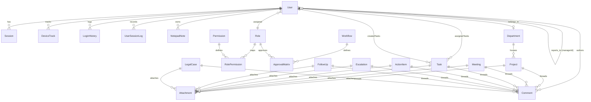
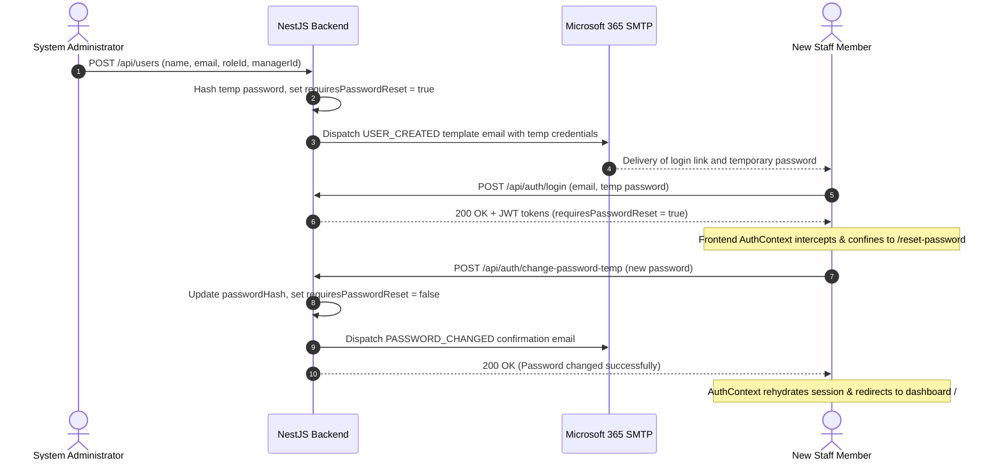

# HARTEK Group CMD Office Command Center — Project Knowledge Base

> **Canonical Living Technical Documentation & Single Source of Truth**  
> *Last Updated: 2026-10-20*  
> *Target Repository Root:* `d:/CMDDashboard-main`

---

## Table of Contents
1. [Document Purpose & Governance Rules](#1-document-purpose--governance-rules)
2. [Project Overview & Core Domain](#2-project-overview--core-domain)
3. [Technology Stack & Dependency Matrix](#3-technology-stack--dependency-matrix)
4. [Repository Structure & File Catalog](#4-repository-structure--file-catalog)
5. [Database Architecture & Data Models (Prisma)](#5-database-architecture--data-models-prisma)
6. [Authentication, Authorization & Security Architecture](#6-authentication-authorization--security-architecture)
7. [Frontend Architecture, State & UI Flows](#7-frontend-architecture-state--ui-flows)
8. [Backend Architecture, Services & Business Logic](#8-backend-architecture-services--business-logic)
9. [API Specification & Frontend-Backend Connectivity](#9-api-specification--frontend-backend-connectivity)
10. [End-to-End System Workflows](#10-end-to-end-system-workflows)
11. [Integrations, Environment & Configuration](#11-integrations-environment--configuration)
12. [Build, Run, Test & Deployment Operations](#12-build-run-test--deployment-operations)
13. [Technical Debt, Known Bugs & Architectural Risks](#13-technical-debt-known-bugs--architectural-risks)
14. [Verified Facts, Assumptions & Living Change History](#14-verified-facts-assumptions--living-change-history)

---

## 1. Document Purpose & Governance Rules

This document serves as the **single source of truth** for understanding the architecture, workflows, data contracts, and implementation details of the HARTEK Group CMD Office Command Center. Future development, refactoring, or maintenance must consult and update this document to prevent redundant codebase re-analysis.

### Governance & Update Protocol (Phases 3 & 4)
Whenever any code change is authorized and implemented in this codebase:
1. **Impact Analysis First**: Before writing code, inspect [PROJECT_KNOWLEDGE.md](file:///d:/CMDDashboard-main/PROJECT_KNOWLEDGE.md) alongside the source code to identify all directly and indirectly affected files, functions, API routes, database operations, and user roles.
2. **Synchronized Documentation Updates**: Update the relevant sections of this document in the **same task** as the code changes. Never leave documentation updates as disconnected future tasks.
3. **Change History Logging**: Append a structured entry to [Section 14: Living Change History](#14-verified-facts-assumptions--living-change-history) detailing:
   - Date and task context.
   - Files modified, created, or deleted.
   - Core behavior before vs. after the change.
   - Potential downstream or migration impacts.
4. **Authoritative Code Rule**: If this document ever contradicts the active source code, **the active source code is authoritative**. In such cases, update this document to reflect active reality.

---

## 2. Project Overview & Core Domain

The **HARTEK Group CMD Office Command Center** is a private enterprise operations dashboard designed for the Chairman & Managing Director (CMD) and executive management of the HARTEK Group (an Indian electrical power systems, renewables EPC, and substation infrastructure conglomerate).

### Primary Functional Domains
- **Executive Command Center**: Real-time aggregation of multi-crore EPC projects, upcoming board/client meetings, hierarchical tasks, cross-departmental escalations, and active litigations.
- **Project Portfolio Management**: Tracking high-value utility EPC projects across stages (`Planning`, `Execution`, `Commissioning`, `Completed`, `On Hold`), health states (`Green`, `Amber`, `Red`), order values (₹ Cr), scheduled vs. revised COD (Commercial Operation Date), physical progress (%), billed vs. collected revenue, and milestone risks.
- **Executive Calendar & Meeting Management**: Scheduling CMD reviews, board meetings, vendor negotiations, and safety committee meetings with attendee tracking, status tracking, agendas, and attached private notes.
- **Hierarchical Task Delegation Engine**: Strict subordinate task dispatching. Non-admin managers can only assign tasks to employees directly reporting to them. Includes batch task dispatching and progress note tracking.
- **Meeting Action Items & Dependencies**: Action point tracking originating from meetings or ad-hoc directives, featuring predecessor dependency blocking (`dep`) and multi-profile delegation (`assignedTo`).
- **Critical Risk Escalation Tracker**: Sequential auto-numbered tracking (`ESC-2026-XX`) for `Critical`, `High`, and `Medium` severity issues across Technical, Commercial, Regulatory, and Resource domains.
- **BU Head Follow-Up Tracker**: Deadline-driven follow-ups targeting specific business unit heads.
- **Legal & Litigation Matrix**: Case tracking across the Punjab & Haryana High Court, MSME arbitration, and district courts. Computes composite risk/status prioritization, tracks Last Date of Hearing (LDOH) and Next Date of Hearing (NDOH), and includes a bulk CSV smart synchronization engine.
- **Contextual Personal Notepad**: Rich private text workspace per user with multi-image attachments and automatic linking to dashboard items via embedded HTML comments (`<!-- item_id: <uuid> -->`).
- **Global Audit Trail**: Automatic JSON delta tracking (pre-edit `oldValues` vs. post-edit `newValues`) for every modifying API action.
- **Administrative Console**: Visual controls for live active user sessions, granular role-permission matrix configuration, real-time white-label branding, Microsoft 365 SMTP connectivity, and dynamic email template management.
- **Progressive Web App (PWA)**: Installable mobile and desktop application with runtime-generated app manifests and responsive canvas-rendered PNG app icons.

---

## 3. Technology Stack & Dependency Matrix

### 3.1. Core Runtime & Tools
| Category | Technology | Version | Location / Config |
| :--- | :--- | :--- | :--- |
| **Runtime** | Node.js | `>= 20.0.0` (LTS recommended) | Engine check in [setup.bat](file:///d:/CMDDashboard-main/setup.bat#L11) |
| **Package Manager** | npm | `>= 9.0.0` | Managed per subproject via [bootstrap.js](file:///d:/CMDDashboard-main/scripts/bootstrap.js) |
| **Process Manager** | PM2 / Concurrently | `concurrently ^8.2.2` | [ecosystem.config.js](file:///d:/CMDDashboard-main/ecosystem.config.js), [package.json](file:///d:/CMDDashboard-main/package.json#L13) |
| **Reverse Proxy** | Nginx | — | [nginx/cmd-dashboard.conf](file:///d:/CMDDashboard-main/nginx/cmd-dashboard.conf) |
| **Operating System** | Windows (Dev) / Ubuntu Linux (Prod) | Windows 11 / Ubuntu 22.04+ | Verified via run scripts and deployment manifests |

### 3.2. Backend Stack ([backend/package.json](file:///d:/CMDDashboard-main/backend/package.json))
| Package | Version | Purpose |
| :--- | :--- | :--- |
| `@nestjs/common`, `@nestjs/core` | `^11.0.1` | Modular backend framework and dependency injection container |
| `@nestjs/platform-express` | `^11.0.1` | Underlying HTTP server adapter for Express |
| `@nestjs/jwt`, `@nestjs/passport` | `^11.0.2`, `^11.0.5` | Passport-based JWT authentication strategy and guards |
| `passport`, `passport-jwt` | `^0.7.0`, `^4.0.1` | JWT extraction from Bearer headers and HttpOnly cookies |
| `@prisma/client`, `prisma` | `^6.4.0` | Database ORM, migration engine, and schema definitions |
| `pg` | `^8.22.0` | Native PostgreSQL connection pool driver |
| `bcrypt` | `^6.0.0` | Salted password hashing (10 salt rounds) |
| `cookie-parser` | `^1.4.7` | Express middleware parsing incoming request cookies |
| `helmet` | `^8.2.0` | Security headers configuration |
| `class-validator`, `class-transformer` | `^0.15.1`, `^0.5.1` | DTO payload structural validation pipes |
| `nodemailer` | `^9.0.3` | Dynamic Microsoft 365 STARTTLS email transport |
| `rxjs` | `^7.8.1` | Reactive streams for interceptors and event piping |
| `reflect-metadata` | `^0.2.2` | TypeScript metadata reflection for NestJS decorators |
| `pdf-parse` | `^2.4.5` | PDF text parsing utility *(currently unreferenced in business logic)* |

### 3.3. Frontend Stack ([frontend/package.json](file:///d:/CMDDashboard-main/frontend/package.json))
| Package | Version | Purpose |
| :--- | :--- | :--- |
| `next` | `16.2.10` | React meta-framework utilizing the App Router |
| `react`, `react-dom` | `19.2.4` | Core UI component and DOM rendering library |
| `react-icons` | `^5.7.0` | Vector icon sets (FontAwesome `Fa*`) used across the UI |
| `typescript` | `^5` | Strict static typing across frontend components |
| `eslint`, `eslint-config-next` | `^9`, `16.2.10` | Next.js linting configuration |

---

## 4. Repository Structure & File Catalog

```
d:\CMDDashboard-main
├── .env.example                       # Reference environment template with default ports and dummy keys
├── ecosystem.config.js                # PM2 process runner definition for background production hosting
├── package.json                       # Root workspace orchestrator managing root scripts
├── run.bat / run.sh                   # Double-click / bash launcher starting dev servers
├── setup.bat / setup.sh               # One-time automated setup (checks, sync, install, push, seed, build)
├── DEPLOYMENT.md                      # Authoritative canonical deployment, rollback & operations guide
├── archive/
│   ├── scripts/                       # Archived dangerous/legacy scripts (clear-db.js, e2e-qa-test.js, pack-zip.js)
│   └── docs/                          # Archived legacy patch guides (PRODUCTION_DEPLOYMENT.md, ROLLBACK.md, etc.)
├── nginx/
│   └── cmd-dashboard.conf             # Production Nginx reverse-proxy configuration (SSL, Gzip, 50MB body)
├── scripts/
│   ├── backup-production.sh           # Linux script creating verified SQL dumps and application tarballs
│   ├── bootstrap.js                   # Node utility installing dependencies across root, backend, frontend
│   ├── build.js                       # Compiles NestJS and Next.js projects with file-mtime intelligence
│   ├── check-db-init.js               # Read-only database safety guard checking existing objects
│   ├── create-admin.js                # CLI utility to create or elevate an Admin user with a custom password
│   ├── deploy-production.sh           # Automated defensive Linux deployment script with isolated builds & auto-rollback
│   ├── deploy.sh                      # Standard Linux deployment forwarding script
│   ├── dev.js                         # Concurrent local dev runner (NestJS watch + Next.js dev)
│   ├── rollback-production.sh         # Linux rollback restoration script restoring .prev candidate snapshots
│   ├── setup-server.sh                # Initial Ubuntu VPS package provisioner
│   ├── start.js                       # Concurrently boots compiled production servers
│   └── sync-env.js                    # Merges .env.example keys into .env and copies to subprojects
├── backend/
│   ├── nest-cli.json                  # NestJS CLI configuration
│   ├── tsconfig.json                  # Backend TypeScript compiler settings
│   ├── tsconfig.build.json            # Production build exclusion list
│   ├── prisma/
│   │   ├── schema.prisma              # Comprehensive Prisma schema containing 36 models
│   │   └── seed.ts                    # Database seeder (Roles, Permissions, Departments, System Users)
│   └── src/
│       ├── main.ts                    # NestJS entry point: prefix, CORS, cookie parser, 50MB limits, migration
│       ├── app.module.ts              # Root NestJS module importing 14 domain modules + global AuditInterceptor
│       ├── app.controller.ts          # Health/root controller
│       ├── app.service.ts             # Health service
│       ├── action-item/               # Meeting-linked action items module
│       ├── audit/                     # Global mutation audit logging service and interceptor
│       ├── auth/                      # Authentication, JWT strategy, login/refresh/logout, MFA OTP, password recovery
│       ├── dashboard/                 # Aggregated KPI and operational metrics service
│       ├── email-templates/           # Dynamic notification email template system
│       ├── escalation/                # Operational issue escalation tracker
│       ├── follow-up/                 # BU follow-ups tracker
│       ├── legal/                     # Litigation case management, NDOH tracking, and CSV import engine
│       ├── meeting/                   # Calendar and meeting scheduling service
│       ├── notepad/                   # User-private contextual notes and image store
│       ├── prisma/                    # Global PrismaService provider
│       ├── project/                   # Multi-crore EPC project portfolio tracker
│       ├── role/                      # Role management and granular permissions configuration
│       ├── settings/                  # Branding configurations and Microsoft 365 SMTP transport
│       ├── task/                      # Subordinate-restricted task delegation engine
│       └── user/                      # User profile management, hierarchy, and session tracking
└── frontend/
    ├── tsconfig.json                  # Frontend TypeScript compiler settings
    ├── package.json                   # Frontend Next.js dependencies and scripts
    └── src/
        ├── app/
        │   ├── layout.tsx             # Root layout: AuthProvider, PWA registration, viewport metadata
        │   ├── globals.css            # 86KB core design system, CSS variables, glassmorphism, responsive styles
        │   ├── page.tsx               # Primary executive command center (6,047 lines, 10 operational panes)
        │   ├── manifest.ts            # Dynamic PWA web manifest generator reading from database settings
        │   ├── admin/
        │   │   ├── page.tsx           # Administrative console (2,872 lines: Users, Roles, Branding, SMTP, Logs)
        │   │   ├── login/page.tsx     # Redirect stub routing to unified /login
        │   │   └── components/
        │   │       └── EmailTemplatesAdmin.tsx # Visual email template designer with live sample preview
        │   ├── components/
        │   │   ├── ProjectsTab.tsx    # Extracted modular projects management tab
        │   │   └── TasksTab.tsx       # Standalone unrendered tasks tab copy (see Technical Debt)
        │   ├── login/page.tsx         # Unified branded login page with MFA/OTP support and live theming
        │   ├── forgot-password/page.tsx # Password recovery and OTP verification form
        │   ├── reset-password/page.tsx  # Mandatory password reset view for temporary/expired credentials
        │   ├── manifest.json/route.ts # Direct HTTP route returning PWA manifest JSON
        │   └── pwa-assets/            # Dynamic route handlers generating responsive PWA PNG icons
        ├── context/
        │   └── AuthContext.tsx        # Centralized React auth state, permission evaluator, route protection
        └── lib/
            ├── api.ts                 # Dynamic API client, 401 refresh interceptor, credentials injector
            ├── pwa-manifest.ts        # PWA configuration resolver reading live settings
            └── serve-pwa-icon.ts      # Canvas-based dynamic icon generator supporting Base64/URLs/Disk
```

---

## 5. Database Architecture & Data Models (Prisma)

The database schema is defined in [backend/prisma/schema.prisma](file:///d:/CMDDashboard-main/backend/prisma/schema.prisma). It maps to a PostgreSQL relational database using UUID primary keys.



### 5.1. Model Classifications
1. **Identity & Access Models**:
   - `User`: Primary user account. Stores `passwordHash`, `initials`, `failedLoginAttempts`, `lockedUntil`, `mfaSecret`, `otpCode`, `requiresPasswordReset`, `immuneFromEscalation`, and soft-delete markers (`deletedAt`, `deletedBy`).
   - `Role`: System or custom roles (`Admin`, `Manager`, `Supervisor`, `Employee`, `Viewer`, `Guest`, `CMD`).
   - `Permission`: Matrix actions (`View`, `Create`, `Edit`, `Delete`, `Export`, `Import`, `Approve`, `Reject`, `Assign`, `Manage`, `Configure`, `Audit`) crossed with resources (`Dashboard`, `Projects`, `Calendar`, `Tasks`, `Actions`, `Escalations`, `Followups`, `Legal`, `Notepad`, `AdminControl`).
   - `RolePermission`: Composite many-to-many join table (`@@id([roleId, permissionId])`).
   - `Session`: Database persistence for issued refresh tokens; enables immediate server-side revocation on logout.
   - `DeviceTrack`: Tracks known devices, browser user agents, last known IP addresses, and activity timestamps.
   - `LoginHistory`: Audit log of all login attempts (`SUCCESS` or `FAILED` with `failureReason`).
   - `UserSessionLog`: Records session duration (`loginTime`, `logoutTime`, IP, user agent) for live active user tracking.

2. **Enterprise Master Tables**:
   - Organization: `Company`, `Branch`, `Department`
   - Geography: `Region`, `Country`, `State`, `City`
   - Finance & Commercial: `Currency`, `Tax`, `FinancialYear`
   - Supply Chain & CRM: `Category`, `Subcategory`, `Product`, `Vendor`, `Customer`
   - Human Resources: `Employee`, `Designation`
   - Workflow & Governance: `Workflow`, `ApprovalMatrix`
   - System Configuration: `SystemSetting`, `FeatureFlag`, `ApiKey`, `BackupSetting`, `License`, `NotificationTemplate`, `EmailTemplate`, `SmsTemplate`

3. **Core Business Operational Entities**:
   - `Project`: EPC infrastructure project with physical progress, financial billing/collection amounts (`Decimal(15, 4)`), target dates (`odate`, `cod`, `rcod`, `mdate`), stage, and health indicator (`Green`, `Amber`, `Red`).
   - `Meeting`: Executive calendar items with categories (`cmd`, `board`, `review`, `vendor`, `safety`, `other`), status (`scheduled`, `done`, `cancelled`), recurrence, venue, attendees, agenda, and private meeting notepad text.
   - `Task`: Assigned operational work item with `batchId`, `assigneeId`, `assignedById`, priority (`High`, `Medium`, `Low`), status (`Open`, `In Progress`, `Done`, `Closed`), target due date (`due`), completion date (`cd`), and latest progress note (`note`).
   - `ActionItem`: Action items linked to meetings or free-standing, owner (`own`), department (`dept`), dependencies (`dep`), and target profile delegation list (`assignedTo` JSON array).
   - `Escalation`: Critical operational roadblocks with auto-generated code (`ESC-2026-XX`), project name, severity (`Critical`, `High`, `Medium`), category, owner, escalated-to party, target resolution date, and status.
   - `FollowUp`: BU-level follow-ups with priority, business unit, BU head, deadline, and status.
   - `LegalCase`: Legal disputes across courts with counsel, party vs. party title, case number, filing side, LDOH, NDOH, status, risk, claim amounts, and hearing timeline JSON.

4. **Supporting & Polymorphic Entities**:
   - `Attachment`: Polymorphic file attachment linking via optional foreign keys to `projectId`, `meetingId`, `taskId`, `actionItemId`, `escalationId`, `followUpId`, or `legalCaseId`. File payloads are stored in the `data` text column as Base64 strings.
   - `Comment`: Polymorphic threaded comments linked via optional foreign keys to the same 7 operational entities plus author `userId`.
   - `NotepadNote`: User-private rich-text scratchpad with JSON array of embedded images (`{id, name, data}`).
   - `AuditLog`: System-wide audit trail recording actor details, action name, route, IP, browser, device, and JSON snapshots of `oldValues` and `newValues`.

---

## 6. Authentication, Authorization & Security Architecture

### 6.1. Dual-Token Architecture
- **Access Token**: Short-lived (15 minutes). Signed with `JWT_SECRET`. Contains minimal identity payload:
  ```typescript
  {
    sub: user.id,
    email: user.email,
    role: user.role.name,
    name: user.name,
    requiresPasswordReset: boolean
  }
  ```
- **Refresh Token**: Long-lived (7 days). Signed with `JWT_REFRESH_SECRET`. Stored simultaneously in an HttpOnly cookie and persisted in the database [Session](file:///d:/CMDDashboard-main/backend/prisma/schema.prisma#L80) table.
- **Token Delivery**: Tokens are set via HttpOnly, SameSite=`lax` cookies (`accessToken`, `refreshToken`). For external API integration, [JwtStrategy](file:///d:/CMDDashboard-main/backend/src/auth/strategies/jwt.strategy.ts#L16) also supports standard `Authorization: Bearer <token>` headers.

### 6.2. Multi-Factor Authentication (MFA) & OTP Verification
1. If a user has `mfaEnabled = true` or supplies an OTP during login:
2. An initial login request with email and password validates credentials. If valid, the server generates a cryptographically random 6-digit numeric OTP code (`crypto.randomInt(100000, 999999)`), stores it with a 5-minute expiry in `user.otpCode`, and dispatches the code via Microsoft 365 SMTP using the `MFA_OTP` template.
3. The server responds with `{ mfaRequired: true, email: user.email }` without issuing tokens.
4. The client prompts the user for the OTP code, which is then submitted in a second login attempt to complete token generation.

### 6.3. Brute-Force & Lockout Protection
- Handled in [AuthService.validateUser](file:///d:/CMDDashboard-main/backend/src/auth/auth.service.ts#L22).
- Tracks consecutive failed attempts in `user.failedLoginAttempts`.
- Upon reaching 5 consecutive failures, `user.lockedUntil` is set to `Date.now() + 15 * 60000` (15-minute lockout). Any login attempt while locked returns `403 Forbidden` with the remaining lockout duration.
- Successful authentication resets `failedLoginAttempts = 0` and clears `lockedUntil`.

### 6.4. Role-Based Access Control (RBAC)
- Enforced on backend controller endpoints via the combined guard:
  ```typescript
  @UseGuards(JwtAuthGuard, PermissionsGuard)
  @RequirePermissions('Action:Resource')
  ```
- [PermissionsGuard](file:///d:/CMDDashboard-main/backend/src/auth/guards/permissions.guard.ts):
  - Checks if `user.role === 'Admin'`. If true, access is universally granted.
  - Otherwise, verifies that the user's role has all required permissions mapped in `user.permissions`.
- **Administrative Account Protection**:
  - In [UserService.update](file:///d:/CMDDashboard-main/backend/src/user/user.service.ts#L121) and [UserService.remove](file:///d:/CMDDashboard-main/backend/src/user/user.service.ts#L299), users cannot deactivate or delete their own active account, demote themselves from Admin, or delete/deactivate the system's last remaining Admin.

### 6.5. Temporary Password Lifecycle
- New staff created by an admin are provisioned with an auto-generated temporary password, setting `requiresPasswordReset = true`.
- On login, [AuthContext](file:///d:/CMDDashboard-main/frontend/src/context/AuthContext.tsx#L62) checks this flag and restricts the browser to `/reset-password`.
- The user must submit a new password to `POST /api/auth/change-password-temp` (which hashes it via bcrypt and sets `requiresPasswordReset = false`) before accessing any dashboard panes.

---

## 7. Frontend Architecture, State & UI Flows

The frontend application uses the Next.js 16 App Router with React 19.

### 7.1. Routing Map
| Path | Component File | Access Level | Description |
| :--- | :--- | :--- | :--- |
| `/` | [app/page.tsx](file:///d:/CMDDashboard-main/frontend/src/app/page.tsx) | Protected (Authenticated) | Main executive command center containing 10 operational module panes. |
| `/admin` | [app/admin/page.tsx](file:///d:/CMDDashboard-main/frontend/src/app/admin/page.tsx) | Protected (Admin Only) | Administrative control panel (Users, Roles, Branding, SMTP, Sessions, Templates). |
| `/admin/login` | [app/admin/login/page.tsx](file:///d:/CMDDashboard-main/frontend/src/app/admin/login/page.tsx) | Public | Redirect stub sending visitors to `/login`. |
| `/login` | [app/login/page.tsx](file:///d:/CMDDashboard-main/frontend/src/app/login/page.tsx) | Public | Branded sign-in portal with MFA OTP input and dynamic theme styling. |
| `/forgot-password` | [app/forgot-password/page.tsx](file:///d:/CMDDashboard-main/frontend/src/app/forgot-password/page.tsx) | Public | Password recovery page generating and verifying OTP reset codes. |
| `/reset-password` | [app/reset-password/page.tsx](file:///d:/CMDDashboard-main/frontend/src/app/reset-password/page.tsx) | Protected (Flagged) | Enforced password change portal for temporary or expired passwords. |
| `/manifest.json` | [app/manifest.json/route.ts](file:///d:/CMDDashboard-main/frontend/src/app/manifest.json/route.ts) | Public | Dynamic PWA manifest route handler generated from database branding. |
| `/pwa-assets/*` | [app/pwa-assets/.../route.ts](file:///d:/CMDDashboard-main/frontend/src/app/pwa-assets) | Public | Route handlers generating responsive PNG application icons on the fly. |

### 7.2. Client State & Context Architecture
- **[AuthContext](file:///d:/CMDDashboard-main/frontend/src/context/AuthContext.tsx)**:
  - Calls `GET /api/auth/me` on mount to rehydrate session identity.
  - Exposes `user`, `loading`, `login()`, `logout()`, `refreshUser()`, and `hasPermission(action, resource)`.
  - Implements route guard logic: unauthenticated users accessing protected paths are redirected to `/login`; users with `requiresPasswordReset` are confined to `/reset-password`; authenticated Admins are directed to `/admin`, and standard users to `/`.
- **Component State**:
  - Main operational data in [page.tsx](file:///d:/CMDDashboard-main/frontend/src/app/page.tsx) is managed via React `useState` hooks. On mount, parallel API calls load projects, meetings, tasks, action items, escalations, follow-ups, legal cases, notepad notes, users, and public settings.
  - Search and filter queries are performed in-memory on the loaded arrays for instant responsiveness, backed by re-fetch calls on CRUD mutations.

### 7.3. Dynamic API Client ([frontend/src/lib/api.ts](file:///d:/CMDDashboard-main/frontend/src/lib/api.ts))
- **Base URL Discovery**: Inspects `process.env.NEXT_PUBLIC_API_URL`. If blank, detects if the browser port is `3000` (resolving to `http://<hostname>:4000/api`) or behind Nginx (resolving to relative `/api`).
- **Automatic 401 Interception**: When an API call returns `401 Unauthorized` (excluding `/auth/login` and `/auth/refresh`), `api.ts` pauses and calls `POST /api/auth/refresh`. If token refresh succeeds, it retries the original request seamlessly. If refresh fails, client state is cleared and the browser redirects to `/login`.

### 7.4. UI Design System ([frontend/src/app/globals.css](file:///d:/CMDDashboard-main/frontend/src/app/globals.css))
- Fully vanilla CSS design system (86KB) styled around executive corporate aesthetics without Tailwind dependencies.
- **Theming Tokens**: Root CSS variables (`--navy: #0F2A4A`, `--accent: #EF9F27`, `--bg: #F4F6F9`, `--card-bg: #FFFFFF`, `--ok: #10B981`, `--warn: #F59E0B`, `--danger: #EF4444`).
- **Dynamic Theming**: Settings loaded from `/api/settings/public` dynamically override `--navy` and `--accent` at runtime on `document.documentElement.style`.
- **Dark Mode**: Comprehensive dark theme activated via `.dark-mode` class on the body.

---

## 8. Backend Architecture, Services & Business Logic

The backend is organized into 16 focused NestJS modules under [backend/src/](file:///d:/CMDDashboard-main/backend/src):

```
backend/src/
├── app.module.ts              # Root module configuring global providers & interceptors
├── main.ts                    # Bootstrap: prefix, cookies, 50MB limits, CORS, startup migration
├── action-item/               # ActionItemController & ActionItemService
├── audit/                     # AuditController, AuditService & AuditInterceptor
├── auth/                      # AuthController, AuthService, JwtStrategy, Guards
├── dashboard/                 # DashboardController & DashboardService
├── email-templates/           # EmailTemplatesController & EmailTemplatesService
├── escalation/                # EscalationController & EscalationService
├── follow-up/                 # FollowUpController & FollowUpService
├── legal/                     # LegalController & LegalService
├── meeting/                   # MeetingController & MeetingService
├── notepad/                   # NotepadController & NotepadService
├── prisma/                    # PrismaModule & PrismaService
├── project/                   # ProjectController & ProjectService
├── role/                      # RoleController & RoleService
├── settings/                  # SettingsController, SettingsService & SettingsMailer
├── task/                      # TaskController & TaskService
└── user/                      # UserController & UserService
```

### Key Service Methods & Business Rules

#### 1. [TaskService](file:///d:/CMDDashboard-main/backend/src/task/task.service.ts)
- `create(dto, userId, roleName)`:
  - If creator is neither `Admin` nor `CMD`, verifies that every assignee in `dto.assigneeIds` has `assigneeUser.managerId === userId`. Throws `403 Forbidden` if attempting to assign to non-subordinates.
  - Generates a shared random alphanumeric `batchId`.
  - Creates a distinct `Task` record for each assignee, attaching any supplied Base64 attachments.
- `findAll(userId, roleName, filters)`:
  - If user is `Admin`, `CMD`, or `Viewer`, returns all tasks across the company.
  - Otherwise, applies boundary filter: tasks where `assigneeId === userId`, `assignedById === userId`, OR `assignee.managerId === userId`.
- `update(id, dto, userId, roleName, userName)`:
  - Only the task creator (`assignedById === userId`) or an `Admin` can modify core task assignments and descriptions.
- `updateProgress(id, dto, userId, roleName, userName)` / `updateStatus(id, status, userId, roleName)`:
  - Assignees can update their own progress notes, completion dates, and status. Marking status `Done` automatically stamps `cd` with the current date.

#### 2. [LegalService](file:///d:/CMDDashboard-main/backend/src/legal/legal.service.ts)
- `findAll(filters)`:
  - Fetches non-deleted legal cases matching court, status, risk, entity, or search filters.
  - Implements custom priority sorting: sorts by composite risk order (`Critical: 0`, `High: 1`, `Medium: 2`, `Low: 3`) plus status order (`Active: 0`, `Pending: 1`, `Settled: 2`, `Favorable: 3`), then ascending by Next Date of Hearing (`ndoh`).
- `importCsv(csvContent, mode, userId, userName)`:
  - Parses uploaded CSV rows, normalizes headers, and detects the petition side (`Filed by` vs. `Filed against`).
  - Evaluates financial claim strings to automatically assign risk levels.
  - In `replace` mode: soft-deletes all existing records before inserting new rows.
  - In `smartSync` mode: matches existing records by case number to update them, or inserts new entries.

#### 3. [AuditInterceptor](file:///d:/CMDDashboard-main/backend/src/audit/audit.interceptor.ts)
- Intercepts all `POST`, `PUT`, and `DELETE` HTTP calls (excluding authentication routes to prevent password capture).
- For `PUT` and `DELETE`, queries the target database table using the route `id` parameter before execution to capture pre-edit `oldValues`.
- Pipes the execution stream with RxJS `tap()`: on success, strips sensitive fields (`passwordHash`, `mfaSecret`) and logs actor ID, email, name, action description, IP address, user agent, browser, device, `oldValues`, and `newValues` into [AuditLog](file:///d:/CMDDashboard-main/backend/prisma/schema.prisma#L634).

#### 4. [SettingsMailer](file:///d:/CMDDashboard-main/backend/src/settings/settings.mailer.ts)
- Dynamically configures a Nodemailer transport using credentials stored in `SystemSetting` (or environment variables).
- `testConnection(overrides)`: Verifies SMTP credentials via `transporter.verify()` and maps Exchange error codes to user-friendly messages.
- `sendTemplateEmail(to, eventKey, variables, defaultSubject, defaultText)`: Queries `EmailTemplate` by `eventKey`. If active, replaces all placeholder tags (e.g. `{{user_name}}`, `{{otp_code}}`) and dispatches the email via SMTP.

---

## 9. API Specification & Frontend-Backend Connectivity

All endpoints are prefixed with `/api`. Protected routes require a valid JWT via cookie or Bearer header.

### 9.1. Authentication Endpoints ([backend/src/auth/auth.controller.ts](file:///d:/CMDDashboard-main/backend/src/auth/auth.controller.ts))
| Method | Endpoint | Access | Payload | Response | Notes |
| :--- | :--- | :--- | :--- | :--- | :--- |
| `POST` | `/auth/login` | Public | `{ email, password, rememberMe?, otp? }` | `{ accessToken, user }` or `{ mfaRequired, email, message }` | Sets HttpOnly cookies: `accessToken` (15m), `refreshToken` (7d). |
| `POST` | `/auth/refresh` | Public (Cookie) | None (reads `refreshToken` cookie) | `{ accessToken }` | Issues fresh access token cookie and payload. |
| `POST` | `/auth/logout` | Public | None (reads `refreshToken` cookie) | `{ message }` | Deletes DB `Session`, updates `UserSessionLog.logoutTime`, clears cookies. |
| `POST` | `/auth/forgot-password` | Public | `{ email }` | `{ success, message, devOtp? }` | Sends reset OTP via SMTP; includes `devOtp` in development mode. |
| `POST` | `/auth/reset-password` | Public | `{ email, otp, newPassword }` | `{ message }` | Verifies OTP code and updates password hash. |
| `POST` | `/auth/change-password-temp` | Protected | `{ newPassword }` | `{ message }` | Sets new password and clears `requiresPasswordReset` flag. |
| `GET` | `/auth/me` | Protected | None | Authenticated user profile + permissions array | Used on frontend mount to verify session. |

### 9.2. Business Module Endpoints
| Resource | Base Endpoint | Permissions | Key Operations |
| :--- | :--- | :--- | :--- |
| **Projects** | `/projects` | `View:Projects`, `Create:Projects`, `Edit:Projects`, `Delete:Projects` | CRUD projects, manage Base64 attachments, query department choices. |
| **Meetings** | `/meetings` | `View:Calendar`, `Create:Calendar`, `Edit:Calendar`, `Delete:Calendar` | CRUD calendar meetings, `PUT /:id/reschedule`, `PUT /:id/status`, `PUT /:id/notes`. |
| **Tasks** | `/tasks` | `View:Tasks`, `Create:Tasks`, `Edit:Tasks`, `Delete:Tasks` | Hierarchical assignment, `PUT /:id/progress`, `PUT /:id/status`. |
| **Action Items** | `/action-items` | `View:Actions`, `Create:Actions`, `Edit:Actions`, `Delete:Actions` | CRUD action items, link to meetings, manage `assignedTo` profile list. |
| **Escalations** | `/escalations` | `View:Escalations`, `Create:Escalations`, `Edit:Escalations`, `Delete:Escalations` | CRUD escalations, auto-code generation, `PUT /:id/status`. |
| **Follow-Ups** | `/follow-ups` | `View:Followups`, `Create:Followups`, `Edit:Followups`, `Delete:Followups` | CRUD follow-ups, `PUT /:id/status`. |
| **Legal** | `/legal-cases` | `View:Legal`, `Create:Legal`, `Edit:Legal`, `Delete:Legal`, `Import:Legal` | CRUD litigation cases, `POST /import-csv` (smartSync or replace). |
| **Notepad** | `/notepad` | User-Private (JWT only) | CRUD private notes, auto-linking items, `DELETE /clear-all`. |
| **Dashboard** | `/dashboard/stats` | Protected | Aggregates live counts (employees, customers, vendors, workflows, total billed). |
| **Audit Logs** | `/audit-logs` | Admin Only | Search and paginate system audit trails with JSON delta snapshots. |

### 9.3. Administrative Endpoints
| Resource | Base Endpoint | Access | Key Operations |
| :--- | :--- | :--- | :--- |
| **Users** | `/users` | Admin Only | User CRUD, `POST /:id/reset-password-temp`, `GET /admin-stats`, `GET /session-logs`. |
| **Roles** | `/roles` | Admin Only | Role CRUD, `GET /permissions` list, assign permission IDs. |
| **Settings** | `/settings` | Public (`/public`) / Admin (`/`) | Read/update branding settings, `POST /smtp/test`, `POST /smtp/test-email`. |
| **Email Templates** | `/email-templates` | Admin Only | Template CRUD, `GET /events`, `PATCH /:id/toggle`, `POST /preview`. |

---

## 10. End-to-End System Workflows

### 10.1. User Provisioning & First-Time Login


### 10.2. Hierarchical Task Delegation & Lifecycle
1. **Creation**: A Manager or CMD user clicks "+ Assign Task" on the Tasks pane.
2. **Subordinate Verification**: [TaskService.create](file:///d:/CMDDashboard-main/backend/src/task/task.service.ts#L9) verifies that all selected assignees report directly to the creator (`assignee.managerId === userId`). System Admins and CMD users bypass this check.
3. **Dispatch**: Generates a shared `batchId` and creates separate `Task` records for each assignee with status `Open`.
4. **Execution**: The assigned employee logs in and sees the task in their private inbox.
5. **Progress Updates**: Assignees open the progress modal and update notes or status via `PUT /api/tasks/:id/progress`.
6. **Completion**: When marked `Done`, the backend automatically stamps the completion date (`cd = TODAY`).
7. **Audit Record**: The global [AuditInterceptor](file:///d:/CMDDashboard-main/backend/src/audit/audit.interceptor.ts) logs the mutation delta with before-and-after values.

### 10.3. Legal Case CSV Import Pipeline
1. The user selects a CSV file and chooses either **Smart Sync** (update matches, insert new) or **Replace** (wipe and replace) mode.
2. The file is uploaded to `POST /api/legal-cases/import-csv`.
3. [LegalService.importCsv](file:///d:/CMDDashboard-main/backend/src/legal/legal.service.ts#L196) parses rows, identifies column indices, and detects petition side banners (`Filed by HPPL` vs. `Filed against HPPL`).
4. Extracts case metadata, maps status values (`Active`, `Stayed`, `Settled`, `Favorable`, `Adverse`, `Pending`), and evaluates financial claim amounts to assign risk levels (`High` if claim $> ₹10,000,000$, else `Low`/`Medium`).
5. Executes database operations within a transaction.
6. The updated cases list is returned, sorted by composite risk and NDOH hearing dates.

---

## 11. Integrations, Environment & Configuration

### 11.1. Microsoft 365 / Exchange SMTP Integration
- Implemented in [SettingsMailer](file:///d:/CMDDashboard-main/backend/src/settings/settings.mailer.ts).
- Default Host: `smtp.office365.com`, Port: `587`, Encryption: `STARTTLS`.
- **Anti-Spoofing Rule**: To avoid Exchange error `554 5.2.252 SendAsDenied`, the sender email is automatically set to match the authenticated SMTP username if the configured sender email is generic or empty.

### 11.2. Environment Variables Specification
Configuration is defined in `.env` (derived from [.env.example](file:///d:/CMDDashboard-main/.env.example)) and synchronized to `backend/.env` and `frontend/.env` via [scripts/sync-env.js](file:///d:/CMDDashboard-main/scripts/sync-env.js).

| Variable | Description | Example / Recommended Setting |
| :--- | :--- | :--- |
| `DATABASE_URL` | PostgreSQL connection URI | `postgresql://<user>:<password>@localhost:5432/<dbname>?schema=public` |
| `JWT_SECRET` | Secret key for signing 15m access tokens | Use a strong 64+ char random string in production |
| `JWT_REFRESH_SECRET` | Secret key for signing 7d refresh tokens | Use a strong distinct 64+ char random string |
| `JWT_ACCESS_EXPIRATION` | Access token lifetime duration | `15m` |
| `JWT_REFRESH_EXPIRATION` | Refresh token lifetime duration | `7d` |
| `SECURE_COOKIES` | Enforce HTTPS Secure flag on cookies | `true` in production; `false` in local HTTP development |
| `PORT` | Backend application port | `4000` |
| `NEXT_PUBLIC_API_URL` | Explicit API URL override (optional) | Leave blank to allow dynamic client discovery |
| `ANTHROPIC_API_KEY` | Key for Claude 3.5 AI extraction | *(Optional / Currently unreferenced in business logic)* |

> [!CAUTION]
> Never commit actual passwords, secrets, or production connection strings to version control.

---

## 12. Build, Run, Test & Deployment Operations

### 12.1. Local Development Setup
1. **Initial Setup**: Run [setup.bat](file:///d:/CMDDashboard-main/setup.bat) (Windows) or [setup.sh](file:///d:/CMDDashboard-main/setup.sh) (Linux):
   - Verifies Node.js and npm installations.
   - Synchronizes `.env` from template.
   - Bootstraps dependencies in root, backend, and frontend.
   - Pushes Prisma schema to PostgreSQL (`prisma db push`).
   - Seeds default roles, departments, permissions, and accounts (`prisma db seed`).
   - Compiles initial application builds.
2. **Daily Development**: Run [run.bat](file:///d:/CMDDashboard-main/run.bat) or `npm run dev`:
   - Synchronizes environment files.
   - Runs NestJS watch server (`:4000`) and Next.js dev server (`:3000`) concurrently.
   - Automatically opens `http://localhost:3000` in the default browser.
3. **Admin User Generation**:
   ```bash
   node scripts/create-admin.js <email> <password> [name] [initials]
   ```

### 12.2. Automated Test Suite
- Run the comprehensive end-to-end QA test suite:
  ```bash
  node scripts/e2e-qa-test.js
  ```
  Verifies admin authentication, role checks, user CRUD, email immutability, temporary password resets, login enforcement, and unauthorized access boundaries.
- Run backend unit tests:
  ```bash
  cd backend && npm run test
  ```

### 12.3. Production VPS Deployment
1. Transfer files or git commit to the production server (e.g. `/var/www/CMDDashboard`).
2. Run the automated deployment script:
   ```bash
   ./scripts/deploy-production.sh
   ```
   - Automatically takes a database backup (`pg_dump`) and application snapshot.
   - Compiles TypeScript builds for backend and frontend.
   - Pushes schema changes (`prisma db push --skip-generate`).
   - Reloads PM2 processes gracefully (`pm2 reload ecosystem.config.js`).
   - Runs a live HTTP health check.
3. **Emergency Rollback**: If a deployment fails, run:
   ```bash
   ./scripts/rollback-production.sh
   ```

---

## 13. Technical Debt, Known Bugs & Architectural Risks

### 1. Incomplete Comment Creation API
- **Location**: [backend/prisma/schema.prisma:591](file:///d:/CMDDashboard-main/backend/prisma/schema.prisma#L591), [backend/src/*/service.ts](file:///d:/CMDDashboard-main/backend/src/)
- **Details**: The `Comment` model is defined in the Prisma schema, and services query `comments` in their `findOne` methods. However, **no comment controller, route, or create method exists** in the backend. Users cannot currently post comments via the API.
- **Risk / Impact**: Comment features in the UI cannot persist data to the server.

### 2. Unrendered Duplicate Component ([TasksTab.tsx](file:///d:/CMDDashboard-main/frontend/src/app/components/TasksTab.tsx))
- **Location**: [frontend/src/app/components/TasksTab.tsx](file:///d:/CMDDashboard-main/frontend/src/app/components/TasksTab.tsx), [frontend/src/app/page.tsx:8](file:///d:/CMDDashboard-main/frontend/src/app/page.tsx#L8)
- **Details**: `TasksTab.tsx` is imported on line 8 of `page.tsx`, but `<TasksTab` is never rendered. Instead, `page.tsx` maintains its own inline implementation of the tasks pane (~230 lines).
- **Risk / Impact**: Code duplication and maintenance confusion. Edits to `TasksTab.tsx` will have no effect on the running dashboard.

### 3. User Hard Delete vs. Soft Delete Inconsistency
- **Location**: [backend/src/user/user.service.ts:341](file:///d:/CMDDashboard-main/backend/src/user/user.service.ts#L341)
- **Details**: Business entities (`Project`, `Task`, `Meeting`, `Escalation`, etc.) use soft deletes (`deletedAt`, `deletedBy`). The `User` model also has `deletedAt` and `deletedBy` fields, and `auth.service.ts` checks for soft-deleted accounts. However, `UserService.remove` executes a permanent **hard delete** (`this.prisma.user.delete`).
- **Risk / Impact**: Hard-deleting users can violate referential integrity or cascade-delete historical associations in logs and assignments.

### 4. Monolithic Page Component Sizes
- **Location**: [frontend/src/app/page.tsx](file:///d:/CMDDashboard-main/frontend/src/app/page.tsx) (6,047 lines), [frontend/src/app/admin/page.tsx](file:///d:/CMDDashboard-main/frontend/src/app/admin/page.tsx) (2,872 lines)
- **Details**: All state, modals, filters, and rendering for 10 operational modules are combined in a single 6,000-line component.
- **Risk / Impact**: High cognitive load, difficult localized debugging, unnecessary component re-renders, and sub-optimal bundle splitting.

### 5. Base64 Attachment Storage in PostgreSQL
- **Location**: [backend/prisma/schema.prisma:565](file:///d:/CMDDashboard-main/backend/prisma/schema.prisma#L565)
- **Details**: Attachments are converted to Base64 strings on the client and stored directly in the `Attachment.data` text column.
- **Risk / Impact**: While acceptable for smaller documents within the 50MB request limit, storing large files in relational tables causes rapid database bloat and slows down backups.

### 6. Startup Role Migration Overhead
- **Location**: [backend/src/main.ts:59](file:///d:/CMDDashboard-main/backend/src/main.ts#L59)
- **Details**: `migrateSuperAdminToAdmin(prisma)` runs unconditionally on every server startup, executing 5 database queries.
- **Risk / Impact**: Adds cold-boot and development watch-mode restart latency.

### 7. Unreferenced Dependencies
- **Location**: [backend/package.json](file:///d:/CMDDashboard-main/backend/package.json#L38), [.env.example](file:///d:/CMDDashboard-main/.env.example#L14)
- **Details**: `pdf-parse` is installed as a production dependency and `ANTHROPIC_API_KEY` is defined in `.env.example`, but neither is imported or referenced in the active codebase.

### 8. Outdated Model Names in Cleanup Script
- **Location**: [scripts/clear-db.js:12,30](file:///d:/CMDDashboard-main/scripts/clear-db.js#L12)
- **Details**: `clear-db.js` calls `prisma.projectComment.deleteMany()` and `prisma.legalCaseComment.deleteMany()`, but the current Prisma schema uses a single consolidated `Comment` model. Running this script will throw runtime property errors.

### 9. Frontend vs. Backend Permission Bypass Discrepancy
- **Location**: [backend/src/auth/guards/permissions.guard.ts:27](file:///d:/CMDDashboard-main/backend/src/auth/guards/permissions.guard.ts#L27) vs. [frontend/src/context/AuthContext.tsx:110](file:///d:/CMDDashboard-main/frontend/src/context/AuthContext.tsx#L110)
- **Details**: The backend guard exempts only `Admin` from permission checks. The frontend `AuthContext` exempts both `Admin` and `CMD`. Furthermore, for `Manager`, `Supervisor`, and `Employee`, the frontend defaults to allowing `View`, `Create`, `Edit`, and `Export` if no explicit resource permissions are loaded, which can cause UI controls to appear enabled even if a restricted backend endpoint would reject the call.

---

## 14. Verified Facts, Assumptions & Living Change History

### 14.1. Verified Facts vs. Assumptions
- **Verified Facts**:
  - The tech stack versions, project architecture, and file paths documented above match active code files on disk.
  - Authentication, password reset, and user creation workflows trigger SMTP emails via Nodemailer with fallbacks.
  - Hierarchical task restrictions enforce direct manager assignment for non-admin users.
  - The global `AuditInterceptor` captures pre/post mutation deltas for `POST`, `PUT`, and `DELETE` requests.
- **Unverified Assumptions / External Constraints**:
  - Microsoft 365 production mailbox health and live DNS/reverse-proxy settings on the live Linux VPS cannot be verified from local disk inspection alone.
  - Whether `ANTHROPIC_API_KEY` and `pdf-parse` are abandoned legacy code or planned future features is undocumented.

---

### 14.2. Living Change History Log

| Date (YYYY-MM-DD) | Author / Context | Files Affected | Summary of Changes | Potential Downstream Impact |
| :--- | :--- | :--- | :--- | :--- |
| **2026-10-20** | Antigravity AI | [PROJECT_KNOWLEDGE.md](file:///d:/CMDDashboard-main/PROJECT_KNOWLEDGE.md) | **Initial Documentation Baseline**: Created comprehensive technical knowledge base documenting full system architecture, dependencies, data models, workflows, APIs, technical debt, and governance rules. | Single source of truth established. No application code modified. |
| **2026-10-21** | Antigravity AI | `archive/scripts/`, `archive/docs/`, `DEPLOYMENT.md`, `frontend/src/app/page.tsx` | **Phase 1 Controlled Repository Cleanup**: Archived dangerous scripts (`clear-db.js`, `e2e-qa-test.js`, `pack-zip.js`) and obsolete patch documentation (`PRODUCTION_DEPLOYMENT.md`, `ROLLBACK.md`, `PATCH_MANIFEST.md`, `deployment_plan.md`); published authoritative canonical `DEPLOYMENT.md`; removed dead unused `TasksTab` import in `page.tsx`. | Zero database impact, zero business logic disruption. Enhanced operational safety. |
| **2026-10-21** | Antigravity AI | `backend/src/audit/audit-sanitizer.ts`, `backend/src/audit/audit.interceptor.ts`, `backend/src/audit/audit.service.ts`, `backend/src/audit/audit-sanitizer.spec.ts`, `backend/src/audit/audit.interceptor.spec.ts` | **Phase 2A Audit Log Storage Optimization**: Implemented pure, recursive sanitizer replacing Base64 Data URIs and raw Base64 payloads with `[BINARY_ATTACHMENT_OMITTED]` and redacting credentials (`[REDACTED]`) before writing to PostgreSQL audit logs. Preserves attachment metadata (`id`, `name`, `type`, `size`) and business fields. Full test coverage (16 new tests, 47 passing). Original application payloads left completely untouched. | Eliminates database bloat in `AuditLog` table. Zero schema changes or breaking changes to API consumers. |
| **2026-10-30** | Antigravity AI | `.gitignore`, `scripts/preflight-staging.sh`, `scripts/deploy-staging.sh`, `scripts/rollback-staging.sh`, `DEPLOYMENT.md`, `backend/src/prisma/staging-safety.spec.ts` | **Staging Readiness & Pre-Provisioning Safety Hardening (F-01 through F-05 & Data Privacy)**: Implemented canonical directory resolution and production directory rejection in staging preflight/deploy scripts (F-01); signal and failure interruption traps, `.prev` preservation, and release identity verification in staging rollback (F-02); comprehensive staging environment file ignore rules in `.gitignore` (F-03); canonical safe database restoration runbook with target validation, `set -euo pipefail`, non-empty & `gzip -t` verification, `psql -v ON_ERROR_STOP=1`, and post-restore record queries (F-04); staging task assignment prerequisites and authorization matrix documenting `Create:Tasks` permission requirement and 401/403/400/201 HTTP status codes (F-05); auditable multi-layer staging data sanitization standard; 21 automated safety tests in `staging-safety.spec.ts` (306 backend tests passing). | Eliminates accidental production deployment risk from staging scripts. Guarantees interruption recovery for rollback operations. Completely protects production databases and data privacy. |

---

*This document must be updated whenever application code, schema, APIs, or architectural decisions are modified in future tasks.*

